# Revisión de descripciones de obra

Borradores generados el 2026-11-20 a partir de las fotografías de cada obra (124 fichas). **Ninguno se publica hasta que lo apruebes.**

## Cómo aprobar

1. Abre `data/artworkDescriptions.ts`.
2. Busca la obra por su id (columna «id» de esta tabla). Cada entrada tiene la forma `"obra-13": d("texto en español", "texto en inglés")`.
3. Para aprobarla, agrega `true` como tercer argumento: `d("…", "…", true)`. Eso equivale a `approved: true`.
4. Si quieres corregir el texto, edítalo ahí mismo (y ajusta el inglés para que siga siendo traducción fiel).

Una descripción aprobada se usa, en este orden: (1) texto alternativo de la imagen, (2) `description` del JSON-LD `VisualArtwork` (solo si también se muestra visible, con la bandera de vista previa), (3) meta description si cabe en 160 caracteres, (4) con `NEXT_PUBLIC_SEO_PREVIEW=1`, un párrafo visible «Sobre la obra».

Para verlas en contexto antes de aprobar: `NEXT_PUBLIC_SEO_PREVIEW=1` en `.env.local` y `npm run dev`; en desarrollo todas aparecen en la ficha con la etiqueta «BORRADOR».

Puntos a revisar con atención: las fotos que muestran una persona delante de la obra o la obra colgada en sala (la descripción lo dice tal cual), las que agrupan varias piezas en una sola foto, y cualquier detalle que no coincida con la obra real.

| id | Título | Miniatura | Descripción (es) | Palabras | Aprobada |
|---|---|---|---|---|---|
| `obra-13` | Nietzsche y Rimbaud diletando sobre muñecas | 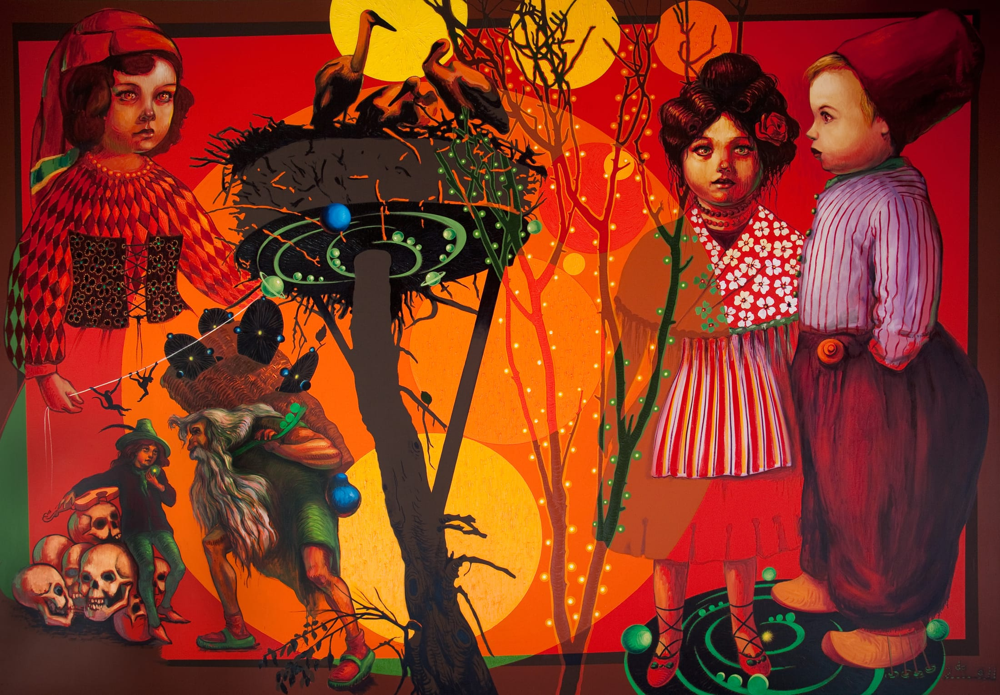 | Acrílico y óleo sobre lienzo en rojos y naranjas. A la izquierda y a la derecha hay niños de rasgos antiguos con gorros rojos; en el centro, un nido de cigüeñas sobre un tronco oscuro, con círculos amarillos detrás. Abajo a la izquierda se ven una pila de calaveras y dos figuras pequeñas con sombrero verde. | 56 | no |
| `obra-132` | Nietzsche y Rimbaud diletando sobre muñecas | 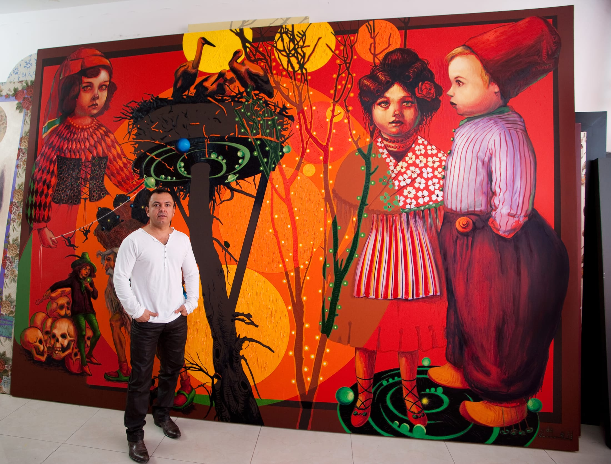 | Vista del lienzo de gran formato apoyado en una pared, con un hombre de camisa blanca y pantalón negro de pie delante. La pintura, de acrílico y óleo sobre lienzo, muestra tres niños, un nido de cigüeñas sobre un tronco oscuro, ramas secas, calaveras y fondos rojos y naranjas con círculos amarillos. | 52 | no |
| `obra-14` | Nebulosa | 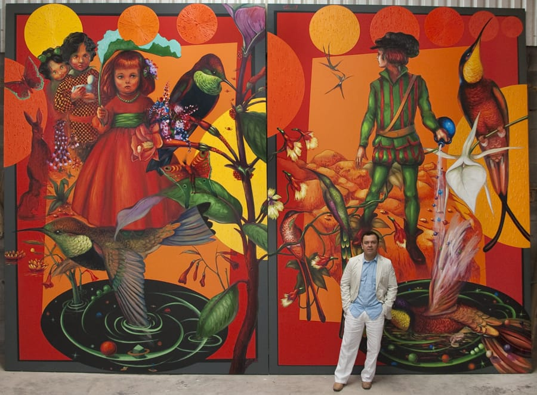 | Díptico de acrílico y óleo sobre lienzo, fotografiado con un hombre de pie delante. A la izquierda, una niña de vestido rojo con otros niños detrás, un colibrí y una liebre; a la derecha, un joven vestido de verde junto a una flor blanca y otro colibrí. Dominan los rojos, naranjas y círculos amarillos. | 54 | no |
| `obra-15` | Nebulosa 1 | 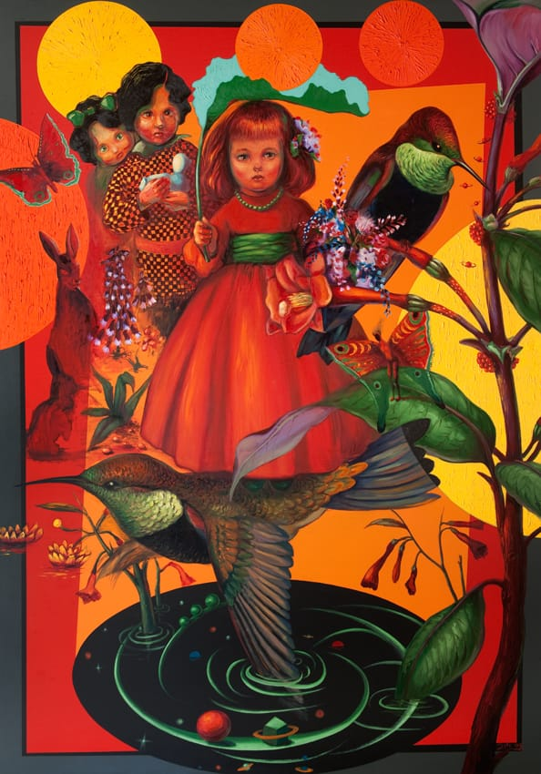 | Acrílico y óleo sobre tela. Una niña pelirroja con vestido rojo y faja verde está de pie en el centro, con otros dos niños y una liebre detrás. Un colibrí grande se hunde en un charco negro con ondas verdes y otra ave se posa a la derecha. Hay círculos naranjas y amarillos y un marco gris. | 57 | no |
| `obra-16` | Soplo de vida | 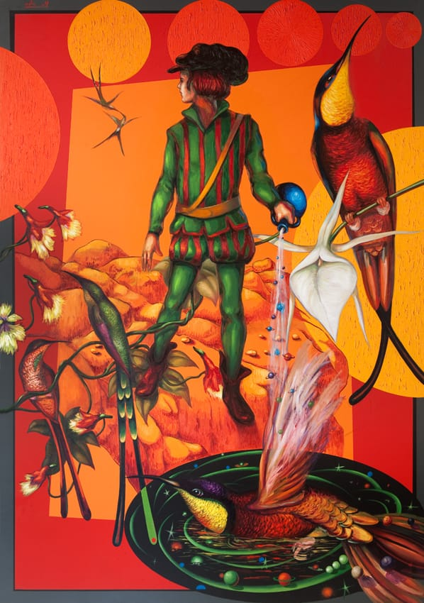 | Óleo sobre tela. Un joven con ropa de rayas verdes y rojas, de espaldas y con la cabeza vuelta, sostiene una esfera azul de la que cae un hilo de gotas hacia un colibrí hundido en un estanque negro. Hay otros colibríes, una flor blanca, rocas naranjas y círculos rojos y amarillos arriba. | 53 | no |
| `obra-17` | Dos ruidos en una bulla | 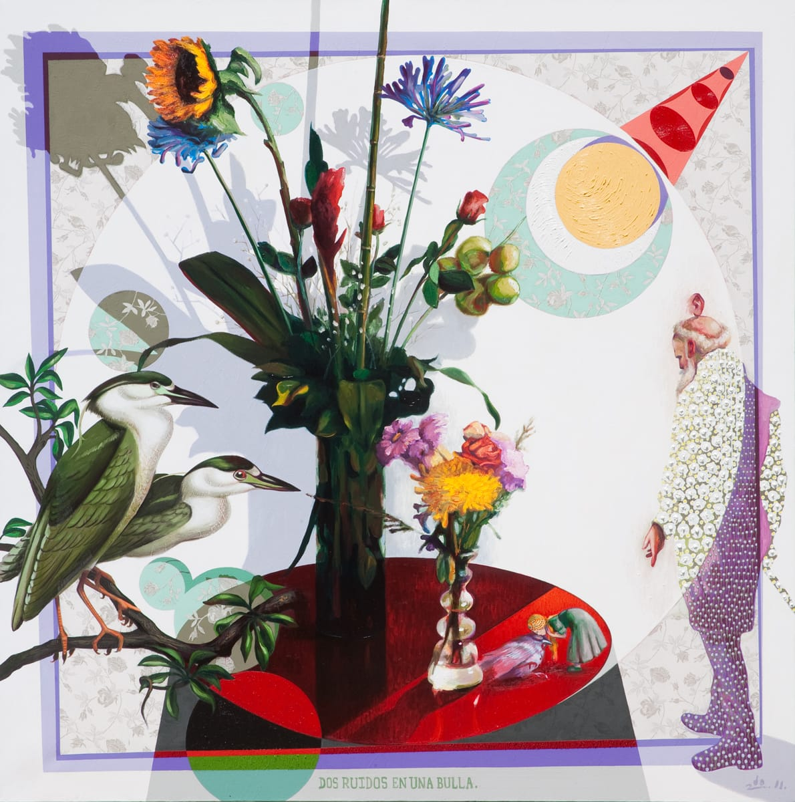 | Acrílico y óleo sobre tela sobre fondo blanco con un gran círculo. Un jarrón alto con girasol, flores azules y rojas ocupa el centro, junto a un florero pequeño sobre una mesa roja. A la izquierda hay dos garzas sobre una rama; a la derecha, una figura con sombrero de cono rojo. Texto al pie. | 55 | no |
| `obra-18` | Dos | 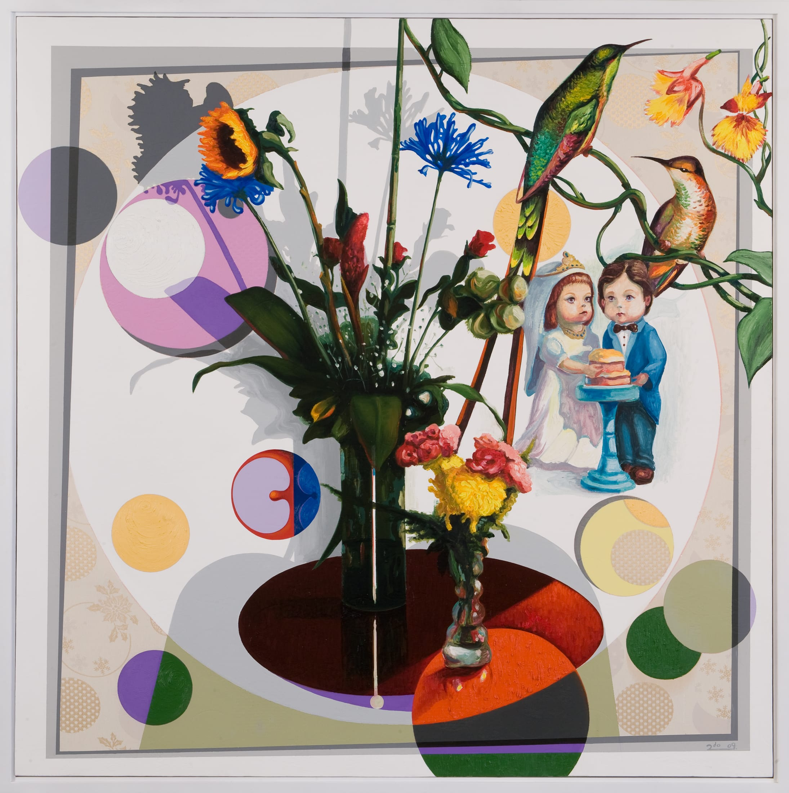 | Óleo y acrílico sobre tela con fondo blanco y círculos de colores traslúcidos. En el centro, un ramo alto de girasol y flores azules y un florero pequeño con flores amarillas y rosas sobre una mesa roja. A la derecha, dos figuritas de novios sostienen un pastel, y dos colibríes se posan en ramas arriba. | 55 | no |
| `obra-19` | Perla bomba | 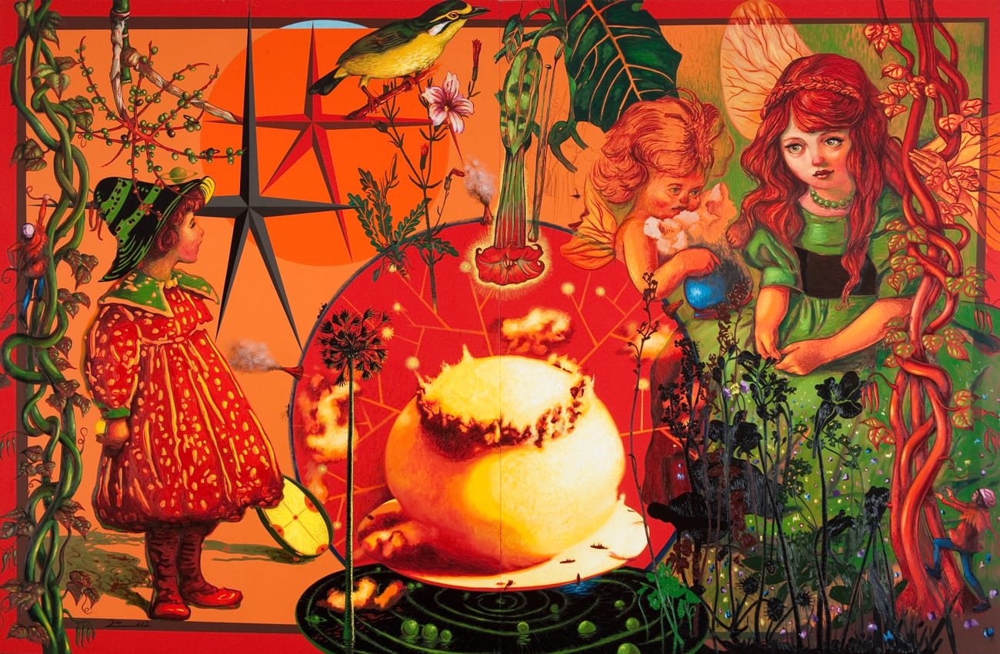 | Una niña de gorro verde y vestido rojo mira hacia una esfera luminosa amarilla que estalla en el centro, sobre un estanque oscuro. A la derecha hay una figura pelirroja con alas y otro niño inclinado. Hay un ave, plantas, estrellas negras y un marco rojo. | 46 | no |
| `obra-20` | Mujer ecológica | 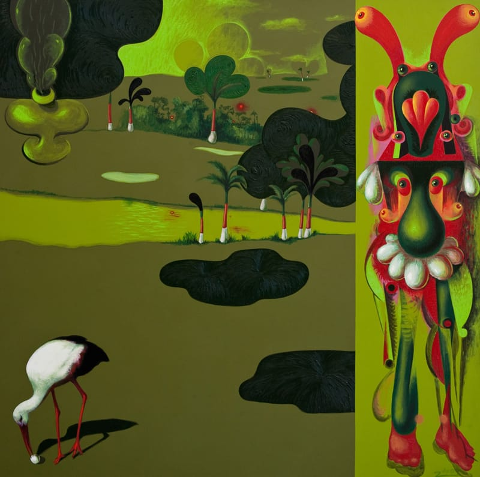 | Acrílico y óleo sobre lienzo en verdes oliva y amarillo ácido. A la izquierda, un paisaje con palmas de tronco rojo y blanco, manchas negras y una cigüeña blanca que picotea en primer plano. A la derecha, en una franja vertical, una figura alargada de ojos redondos, nariz verde y adornos rojos. | 52 | no |
| `obra-21` | Big Bang | 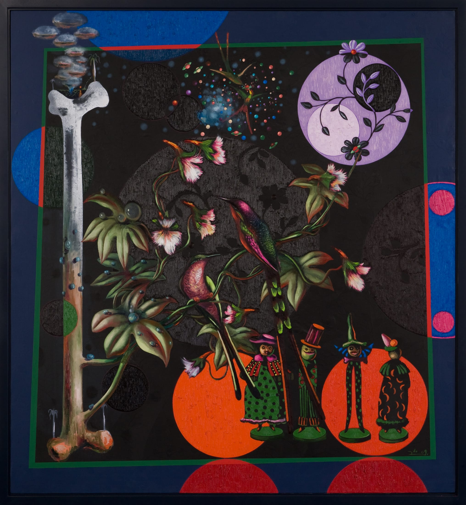 | Óleo y acrílico sobre fondo azul oscuro con un recuadro negro y borde verde. A la izquierda, un hueso blanco muy alto del que salen hojas y flores rosadas. Un colibrí se posa entre ramas, hay una nube de puntos de colores arriba, una luna violeta y cuatro figuras pequeñas sobre círculos naranjas. | 53 | no |
| `obra-22` | La mar. La-mer | 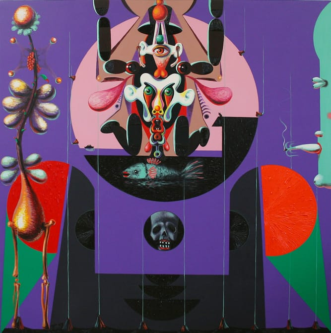 | Acrílico y óleo sobre fondo violeta. Arriba, una figura simétrica de formas negras, rosadas y blancas con un ojo y una boca abiertos; debajo, un pez sobre un semicírculo negro y una calavera en un círculo. A los lados hay semicírculos rojos, una planta de bulbos con patas y hilos verticales finos. | 52 | no |
| `obra-23` | Espejos | 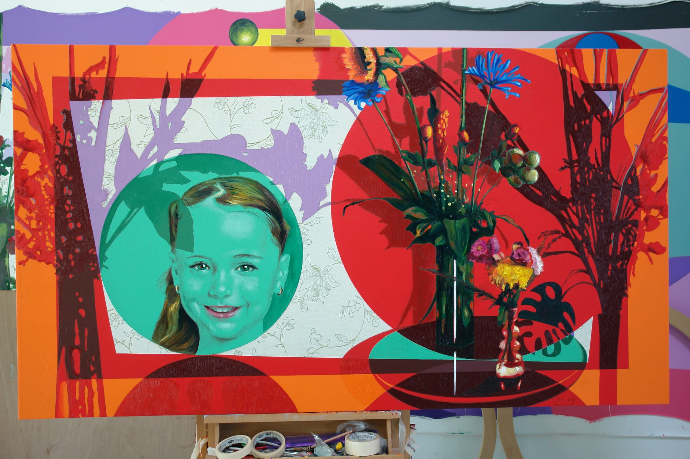 | Pintura de acrílico y óleo sobre lienzo, fotografiada sobre un caballete en el taller. Un retrato sonriente de una niña, en tonos verde turquesa, ocupa un círculo a la izquierda. A la derecha, un jarrón con flores azules y rojas sobre una mesa, con sombras de plantas en rojo oscuro y marco naranja. | 53 | no |
| `obra-24` | Dos lunas y cuatro puntos cardinales | 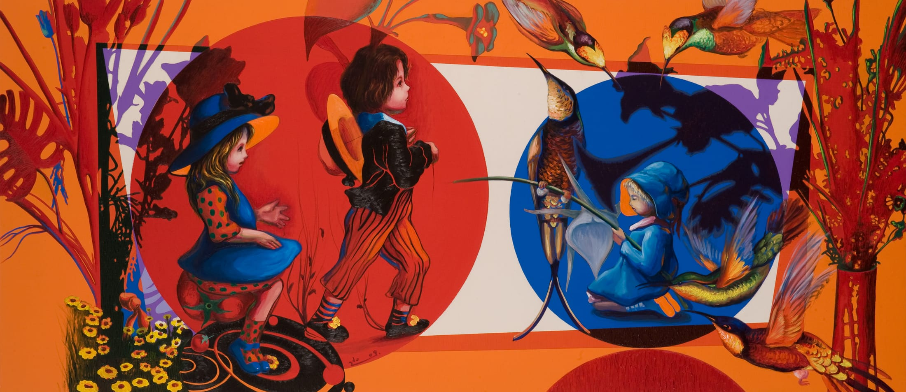 | Acrílico y óleo sobre tela, de formato horizontal, con fondo naranja. A la izquierda, una niña con sombrero azul y un niño de pantalón de rayas caminan sobre un círculo rojo. A la derecha, otra niña de capa azul está dentro de un círculo azul, rodeada de colibríes. Hay plantas rojas en los bordes. | 54 | no |
| `obra-25` | Más dos | 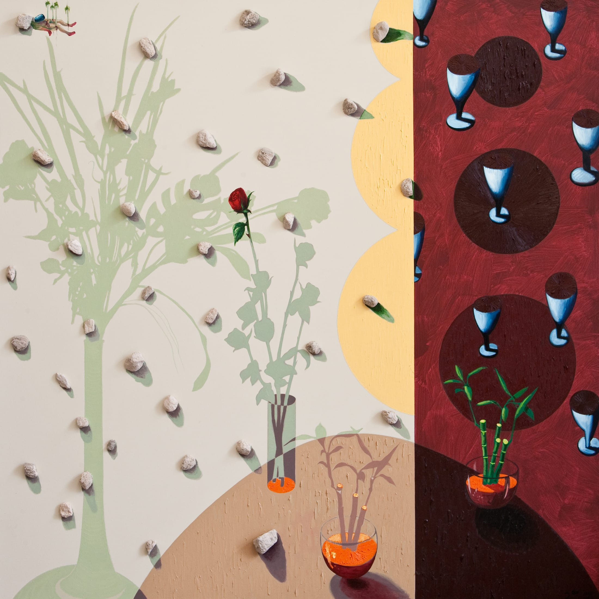 | Acrílico, óleo y piedra sobre lienzo. Sobre un fondo crema se ven siluetas verdes pálidas de jarrones y plantas, y piedras pequeñas pegadas a la superficie que proyectan sombra. A la derecha, una franja rojiza con copas azules, y abajo una mesa beige con dos vasos, una rosa y un bambú. | 51 | no |
| `obra-26` | Por fin | 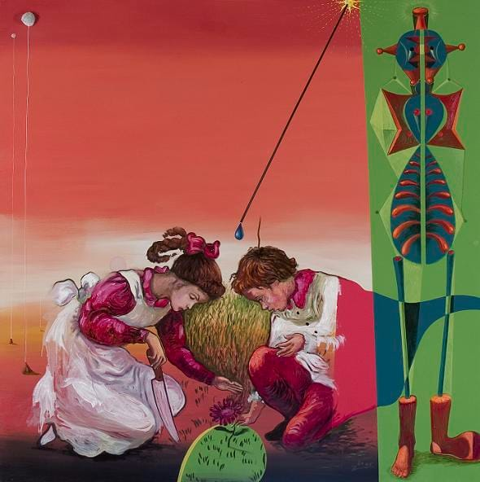 | Acrílico y óleo. Dos niños de ropa rosada y blanca se agachan sobre una pequeña planta de flor morada; ella sostiene un cuchillo. Detrás hay un cielo rojo y naranja degradado y una línea que baja con una gota azul. A la derecha, una franja verde con una figura alargada de patas y botas. | 54 | no |
| `obra-27` | Fu-gas | 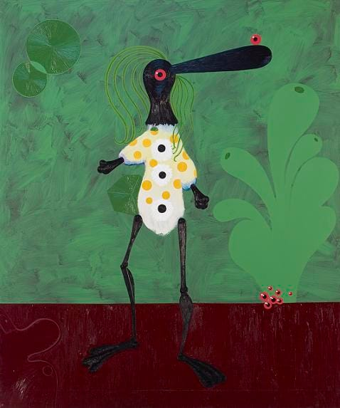 | Una figura de pie con cabeza negra, pico largo y oscuro y un ojo rojo, vestida con una prenda blanca con lunares amarillos y negros, sobre patas delgadas con membranas. El fondo verde de pincelada visible lleva una forma vegetal verde claro a la derecha y una franja burdeos en la base. Técnica: acrílico y óleo. | 56 | no |
| `obra-28` | Mesa de villar | 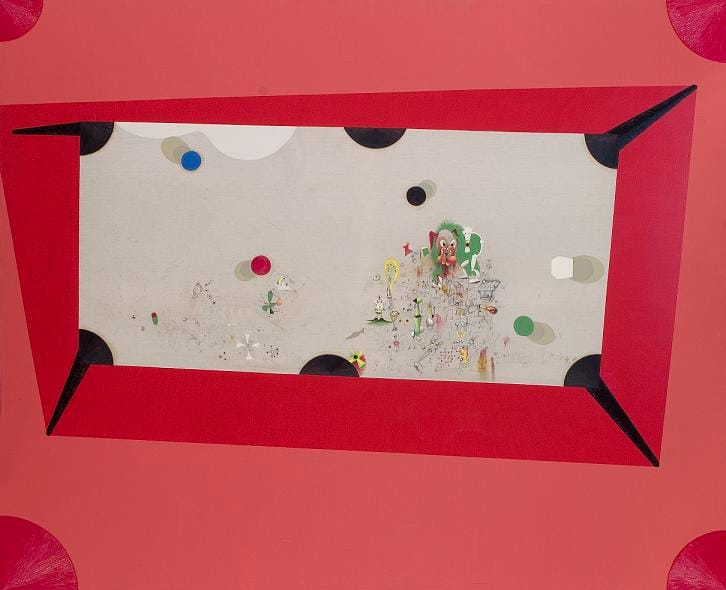 | Una mesa de billar vista desde arriba, con un paño gris claro enmarcado por bordes rojos y rodeado de un fondo rosa rojizo, con círculos rojos en las esquinas. Sobre el paño hay bolas de colores y, en el centro, un grupo de pequeños dibujos y figuras finas. Técnica: acrílico y óleo. | 52 | no |
| `obra-29` | Adán y Eva | 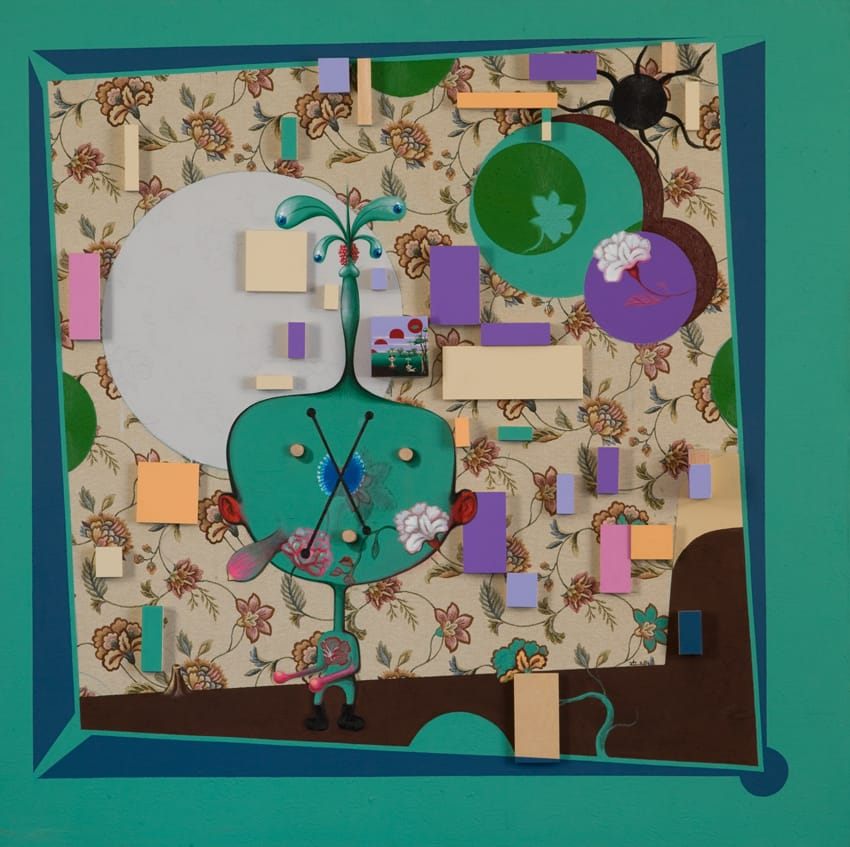 | Sobre una tela de flores sobre fondo crema hay una figura verde de cabeza redonda con dos palos cruzados en el rostro, rodeada de rectángulos de madera en rosa, lila, naranja y beige. Un círculo blanco grande, círculos verdes y morados y un marco azul sobre fondo verdoso completan la composición. Técnica: acrílico, óleo y madera sobre lienzo. | 58 | no |
| `obra-30` | Em el villar | 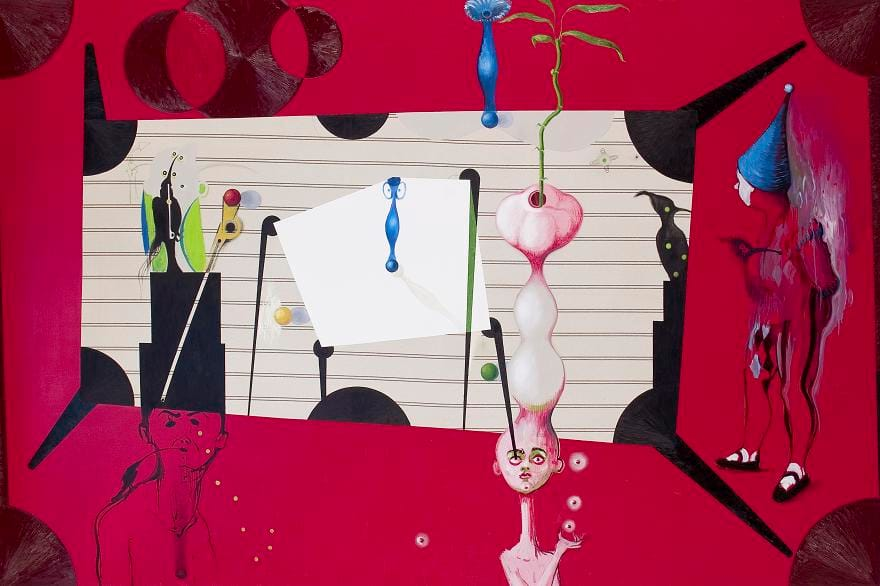 | Un marco rojo de bordes angulosos y esquinas negras rodea un fondo claro con rayas horizontales finas, como un pentagrama. Dentro hay una hoja blanca, una figura con sombrero negro y cabeza rosada y una cabeza que sostiene un tallo; a la derecha, un personaje con gorro azul puntiagudo. Técnica: acrílico y óleo. | 53 | no |
| `obra-31` | Mientras | 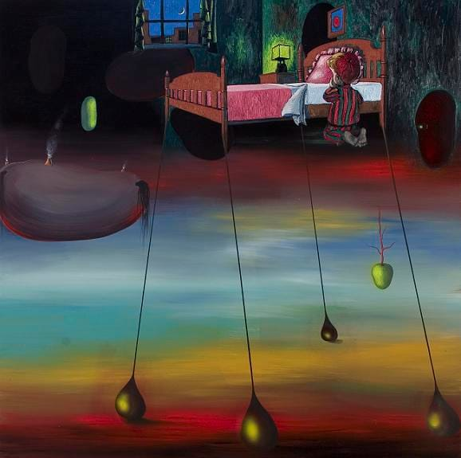 | Un niño con pijama de rayas reza arrodillado junto a una cama con colcha rosa, en un cuarto oscuro con ventana y luna. El suelo es una franja horizontal de rojo, azul, verde y amarillo. Cuatro hilos negros cuelgan del techo con gotas de luz amarilla en el extremo, junto a una manzana verde y una mancha gris flotante. Técnica: acrílico y óleo. | 63 | no |
| `obra-32` | “A” | 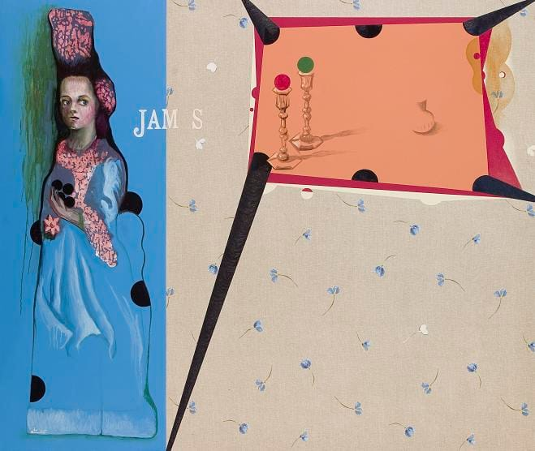 | A la izquierda, sobre una banda azul, una mujer de vestido azul y peinado alto rosa sostiene bolas negras. A la derecha, sobre un fondo de lino con florecillas azules, hay una mesa de billar naranja con dos candeleros y una pieza pequeña, y las letras blancas «JAM S». Una gran diagonal negra cruza la tela. Técnica: acrílico y óleo. | 60 | no |
| `obra-33` | En la distancia; el sonido de tu sombra | 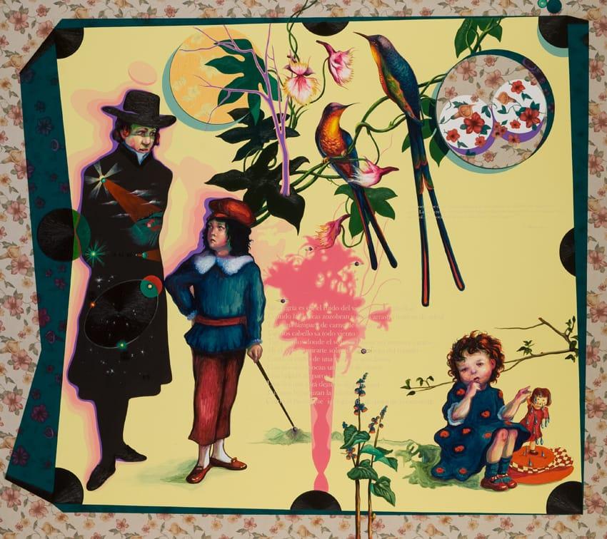 | Sobre un fondo amarillo pálido enmarcado por tela de flores, un hombre de abrigo negro con sombrero y un niño de gorro rojo con un bastón están de pie a la izquierda. Arriba cuelgan dos colibríes de colores y ramas con flores. Abajo a la derecha, una niña sentada sostiene una muñeca; una mancha rosa cae al centro. Técnica: acrílico y óleo sobre tela. | 64 | no |
| `obra-34` | Sobrepesada sombra de trompa y tiempo | 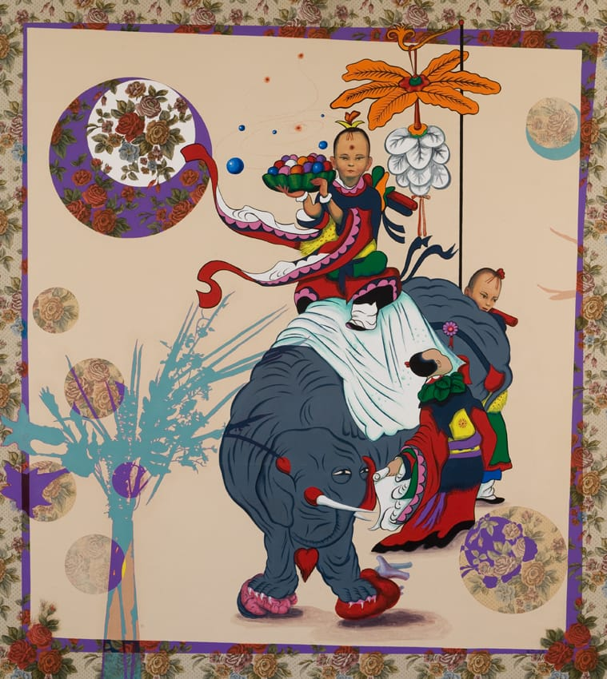 | Un niño con adorno en la cabeza, vestido con túnica de colores y una bandeja de frutas, va sentado sobre un elefante gris que lleva una mujer inclinada y otro niño detrás. El fondo es color durazno con borde morado y tela de flores en el marco. A la izquierda hay una mancha turquesa y círculos con estampado floral. Técnica: acrílico y óleo sobre lienzo. | 65 | no |
| `obra-35` | Encanto de las edades. Trece punto cero, diez veintitrés | 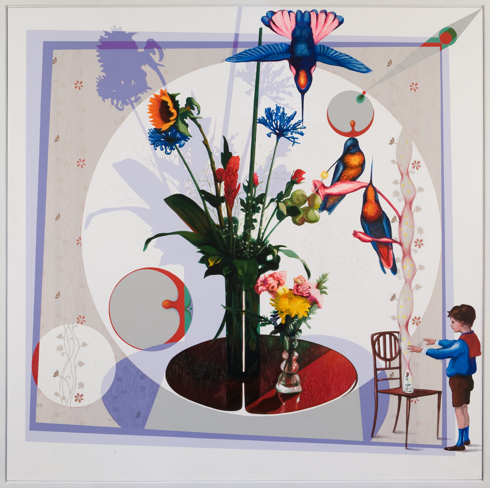 | En el centro, un jarrón alto con girasol, flores azules, rojas y amarillas sobre una mesa redonda oscura, dentro de un gran círculo blanco. Tres colibríes azules y naranjas vuelan arriba a la derecha, y un niño con suéter azul extiende las manos junto a una silla. El fondo es blanco y lila. Técnica: acrílico y óleo. | 57 | no |
| `obra-36` | Sueño | 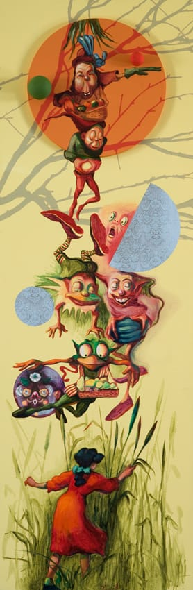 | Un lienzo muy vertical y estrecho sobre fondo amarillo pálido con ramas grises. Una pila de criaturas de rostros grotescos, rojas y verdes, está apilada bajo un círculo naranja; abajo, una mujer de vestido rojo y pelo oscuro camina entre hierba alta. Hay dos círculos azul grisáceo con estampado. Técnica: acrílico y óleo sobre tela. | 55 | no |
| `obra-37` | Circo | 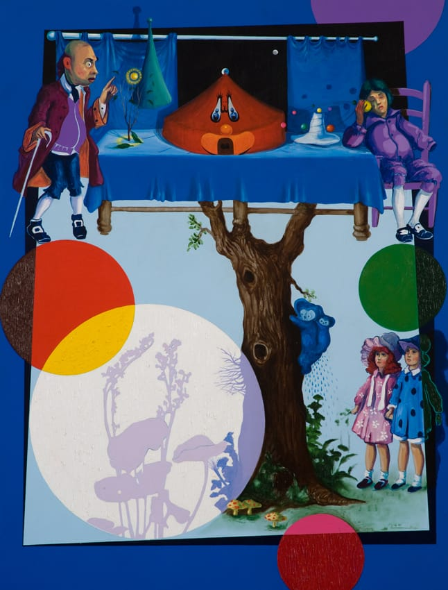 | Sobre un fondo azul intenso, un cuadro enmarcado en negro muestra una mesa con mantel azul: a la izquierda un hombre calvo con bastón, al centro un objeto naranja en forma de carpa con cara y a la derecha una figura morada sentada. Bajo la mesa hay un árbol, un osito azul y dos niñas, entre círculos de colores. Técnica: acrílico y óleo sobre tela. | 65 | no |
| `obra-38` | Plenamente helado, en tanto un hedor a cordura y ansiedad son los colores limpios y brillantes del recuerdo | 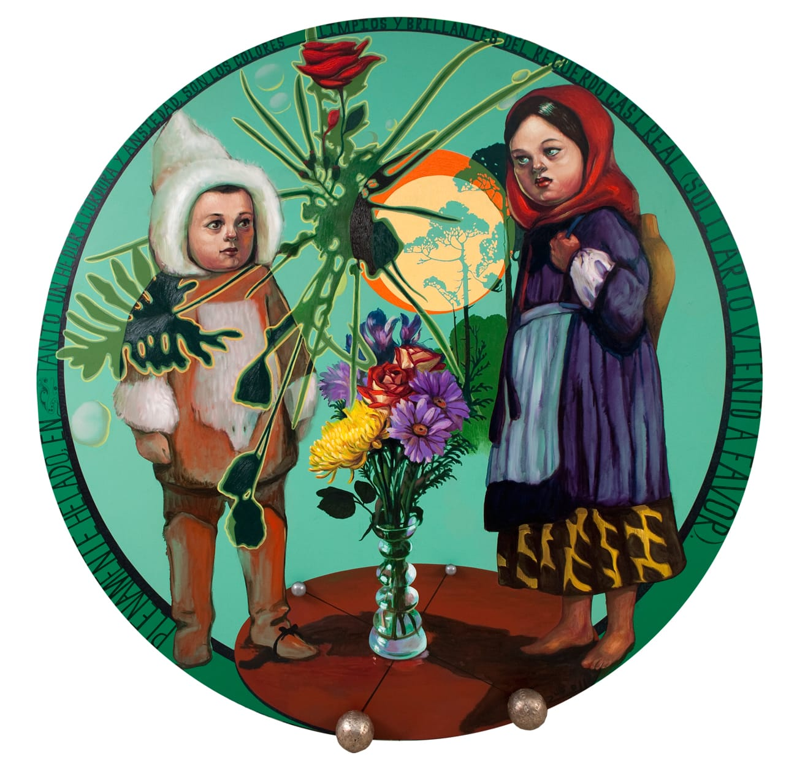 | Obra circular sobre fondo verde agua con borde verde oscuro y texto escrito alrededor. Un niño con gorro blanco de piel y una niña con pañuelo rojo y falda estampada flanquean un jarrón de cristal con flores, sobre una mesa redonda marrón con dos esferas. Detrás, una rosa roja y un sol amarillo. Técnica: acrílico y óleo sobre lienzo. | 59 | no |
| `obra-39` | Salvación del tiempo tallado en espuma | 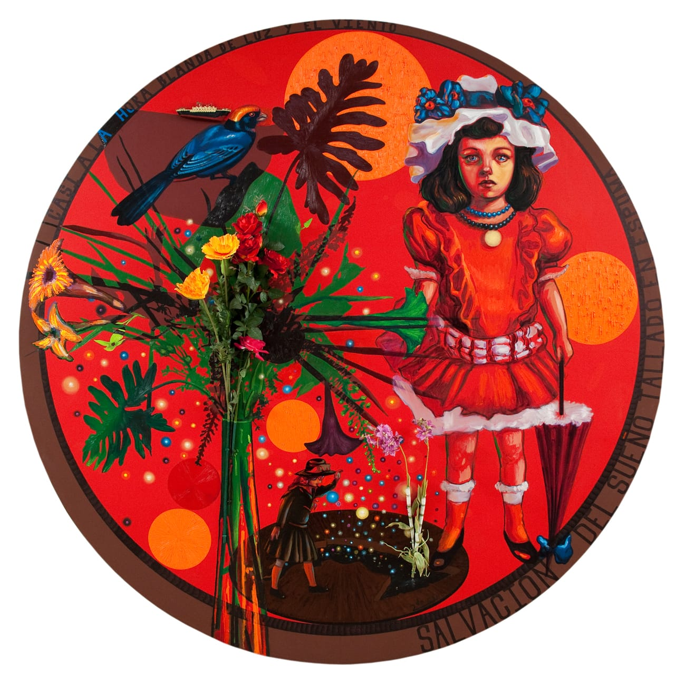 | Obra circular de fondo rojo con una niña de vestido rojo, sombrero blanco con flores azules y paraguas cerrado. A la izquierda, un ramo de flores reales sobresale de un jarrón de vidrio, junto a un pájaro azul, hojas oscuras y círculos naranjas. Abajo, una figura pequeña camina sobre un suelo oscuro con puntos de luz; texto en el borde marrón. Técnica: acrílico, óleo y flores sobre lienzo sobre madera. | 70 | no |
| `obra-40` | Cada espuela en el tiempo, evoca la palabra olvido del decir | 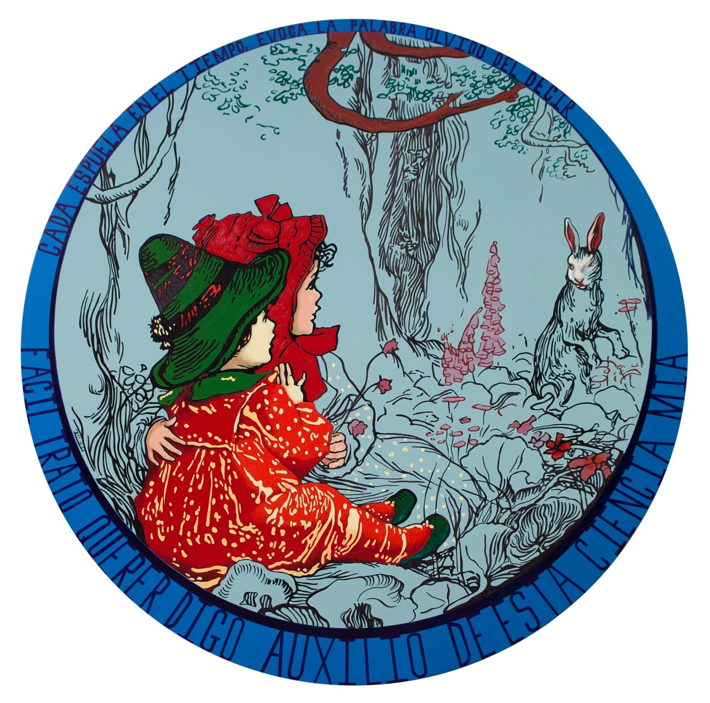 | Obra circular con borde azul y texto alrededor. Dos niños de espaldas, con sombrero verde y gorro rojo y vestido rojo con puntos claros, se sientan en un bosque de líneas finas en gris azulado. A la derecha, un conejo gris está de pie entre flores rosadas. Técnica: acrílico, marcador y óleo sobre lienzo. | 54 | no |
| `obra-41` | Profundo sostén de las sombras | 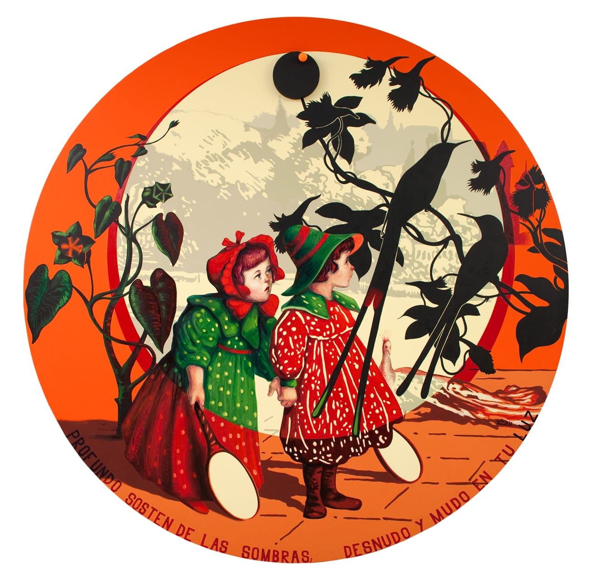 | Obra circular de fondo naranja con dos niñas de la mano, una con vestido verde de lunares y gorro rojo, otra con vestido rojo y sombrero verde. Detrás hay un círculo claro con un paisaje gris y siluetas negras de aves y hojas; hojas verdes a ambos lados y texto en la base. Técnica: acrílico y óleo sobre lienzo, sobre madera. | 61 | no |
| `obra-42` | Siendo de la memoria el cielo | 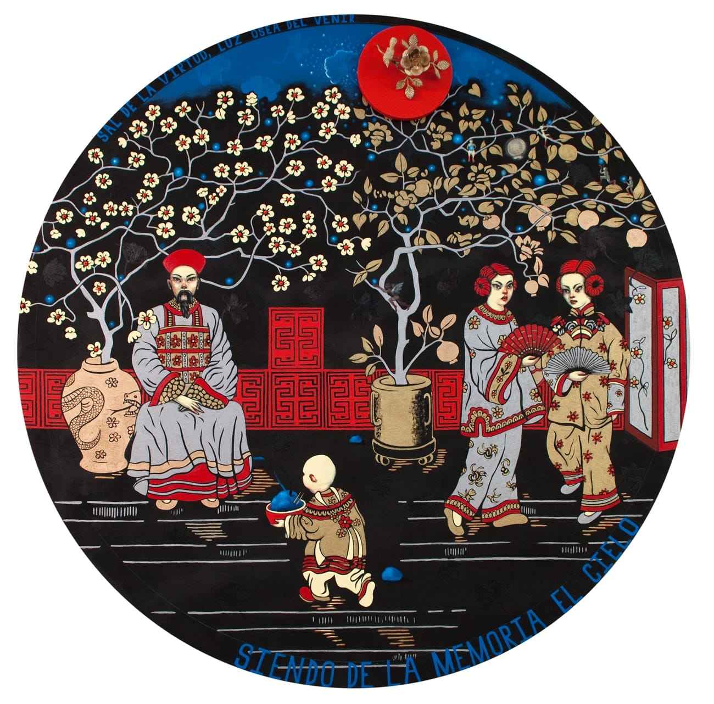 | Pintura de formato circular sobre fondo negro, con un cielo azul en la parte superior y un disco rojo con una pequeña flor en relieve. En un patio con muro rojo aparecen un hombre sentado con gorro rojo, dos mujeres con abanicos, un niño agachado y árboles en flor. Técnica: acrílico, óleo, rosa y pájaro de bronce sobre lienzo, montada en madera. | 62 | no |
| `obra-43` | Entorno al aliento | 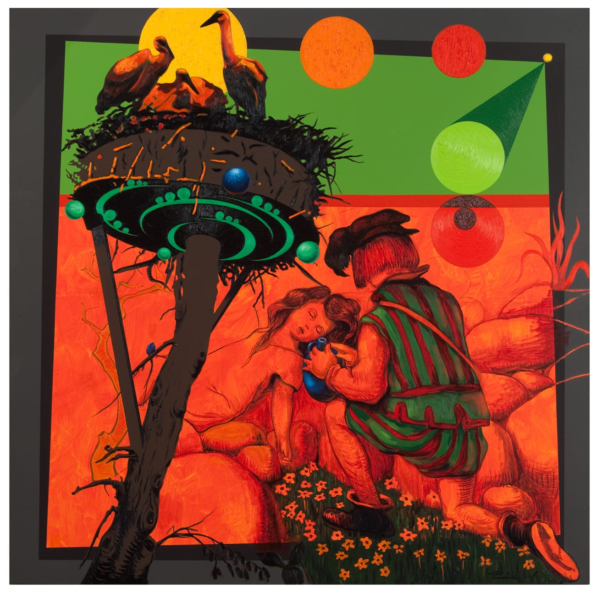 | Escena sobre fondo naranja intenso y una franja verde superior. A la izquierda, un nido de cigüeñas con tres aves sobre un poste, con un disco oscuro de anillos verdes. A la derecha, un joven de espaldas con jubón a rayas sostiene a una figura dormida. Círculos de colores flotan arriba. Técnica: acrílico y óleo sobre lienzo. | 57 | no |
| `obra-44` | Pérdida de vista, camelia de luz blanda | 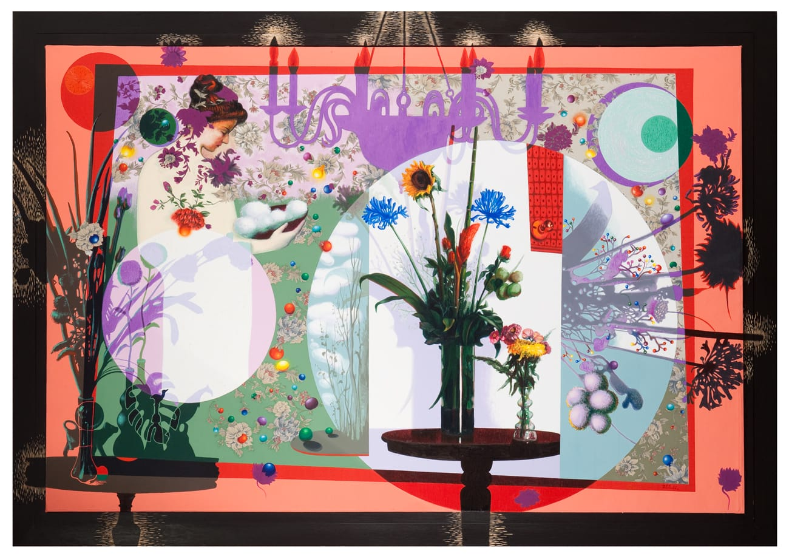 | Cuadro con marco negro decorado y un fondo rosa salmón con papel floral. Al centro, un florero de vidrio sobre una mesa redonda con girasol, flores azules y rojas. Un candelabro morado cuelga arriba, una mujer de perfil aparece a la izquierda y grandes círculos blancos se superponen con siluetas de plantas. Técnica: acrílico y óleo sobre lienzo. | 58 | no |
| `obra-45` | Universo Etéreo | 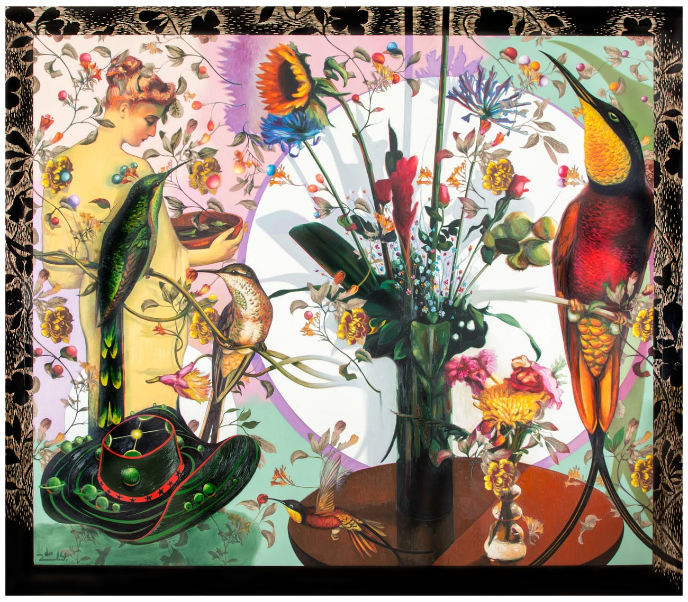 | Un ramo en jarrón y una mesa redonda ocupan el centro, rodeados de colibríes de pecho rojo y verde. A la izquierda, una mujer de perfil sostiene un cuenco, y un sombrero negro con cuentas verdes descansa abajo. El fondo es de papel floral en tonos pastel, con un marco negro grabado. Técnica: óleo sobre lienzo. | 56 | no |
| `obra-46` | Verbo cardinales | 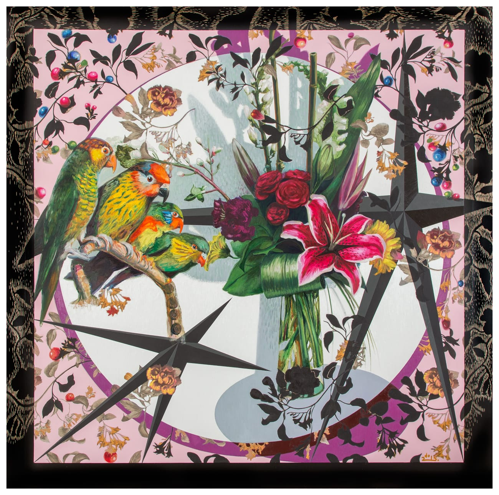 | Cuatro loros de plumaje verde, amarillo y naranja se posan en una rama a la izquierda. A la derecha, un ramo con rosas rojas y un lirio rosado sale de un jarrón de vidrio. Detrás hay un gran círculo blanco con borde morado y dos estrellas negras de varias puntas. El fondo rosa lleva flores y bayas. Técnica: acrílico y óleo sobre lienzo. | 63 | no |
| `obra-47` | Espejo | 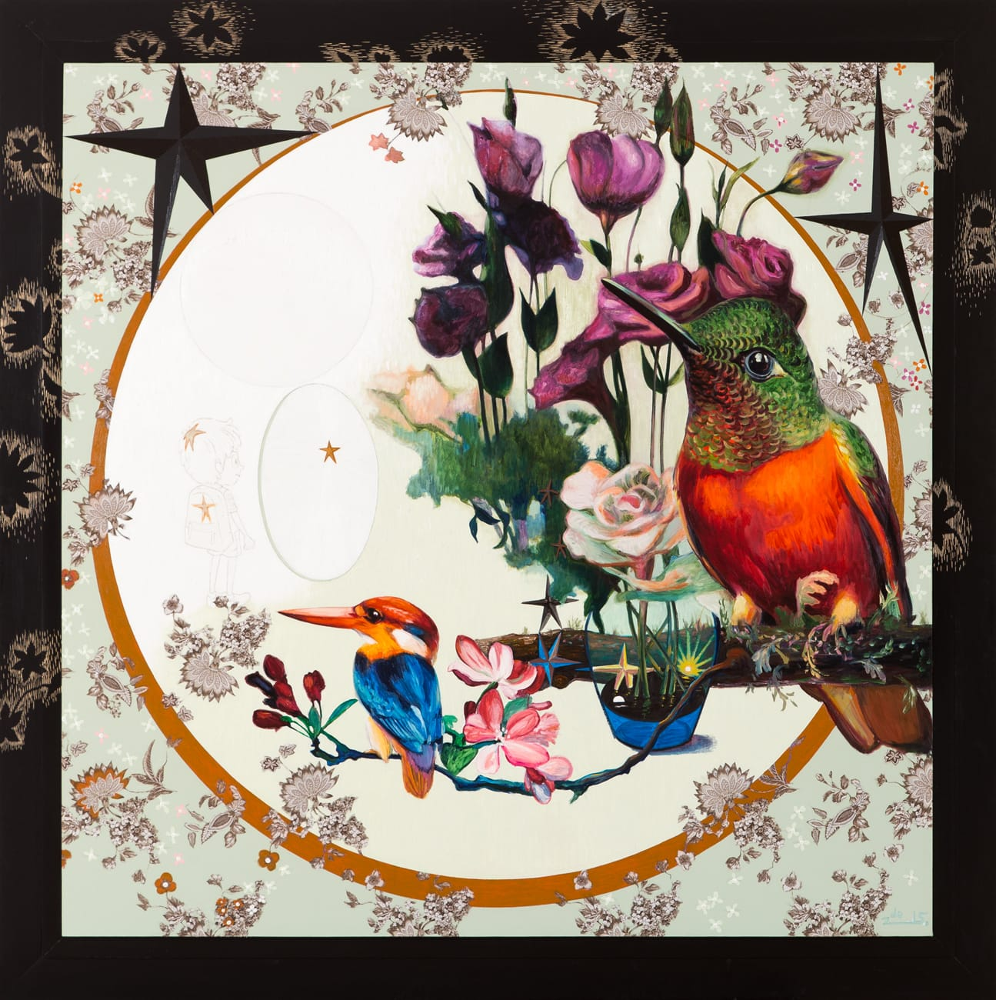 | En un gran círculo blanco con borde dorado, un colibrí de pecho naranja y dorso verde se posa en una rama junto a rosas y lisianthus morados. Abajo a la izquierda, un martín pescador azul y naranja está sobre ramas con flores rosadas. Dos estrellas negras asoman en las esquinas, sobre papel floral verde pálido. Técnica: acrílico y óleo sobre lienzo. | 61 | no |
| `obra-48` | Invierno | 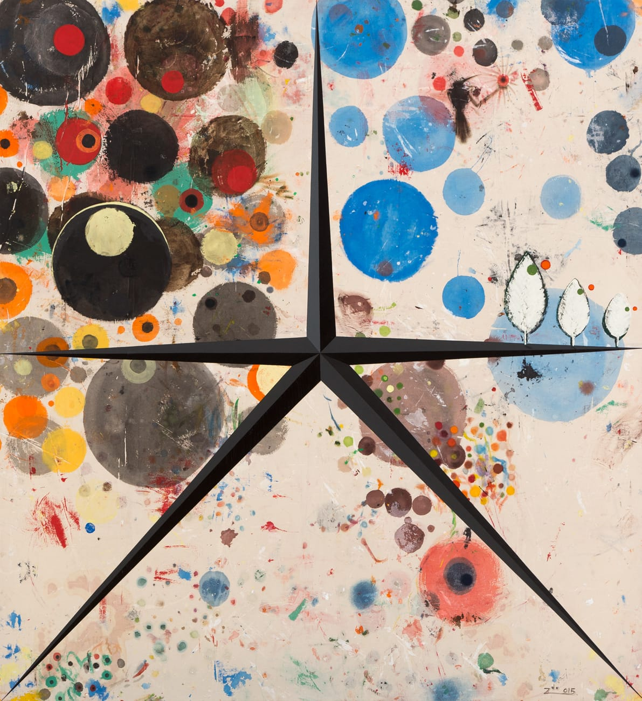 | Una gran estrella negra de cinco puntas cruza el lienzo y lo divide en sectores sobre fondo crema. Hay muchos círculos de distintos tamaños: negros, marrones y naranjas a la izquierda, azules a la derecha. Tres hojas blancas se alinean sobre un círculo azul, y salpicaduras de pintura cubren la superficie. Técnica: acrílico y óleo sobre lienzo. | 57 | no |
| `obra-49` | Cazador de estrellas | 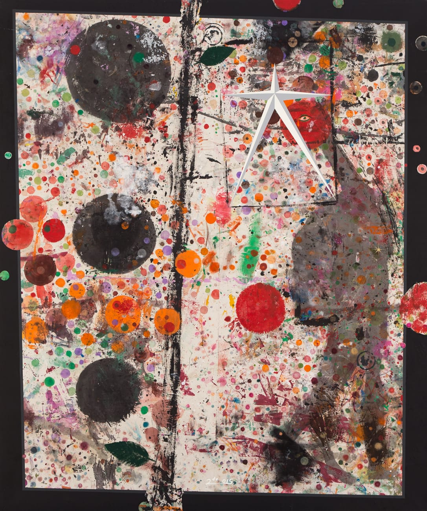 | Superficie crema cubierta de salpicaduras, puntos y manchas de colores, con círculos grandes negros, rojos y naranjas. Una columna oscura vertical atraviesa la imagen por la izquierda y una pequeña estrella blanca aparece arriba a la derecha. Una sombra gris ocupa el lado derecho y un borde negro rodea la obra. Técnica: acrílico y óleo sobre lienzo. | 57 | no |
| `obra-50` | El viaje | 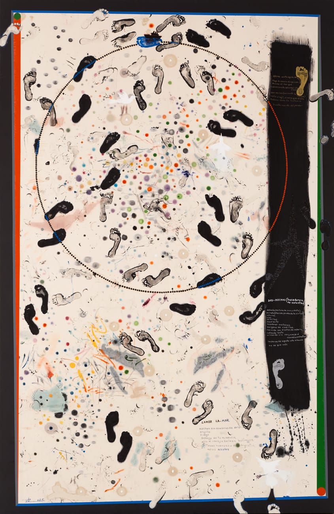 | Sobre fondo crema se ven numerosas huellas de pies, negras y grises, dispuestas dentro y fuera de un gran círculo de puntos. Hay puntos de colores y manchas dispersas. A la derecha, una banda vertical negra lleva texto escrito en blanco. Bordes finos naranja y verde enmarcan los lados. Técnica: acrílico y óleo sobre lienzo. | 55 | no |
| `obra-51` | Estrellas verdes | 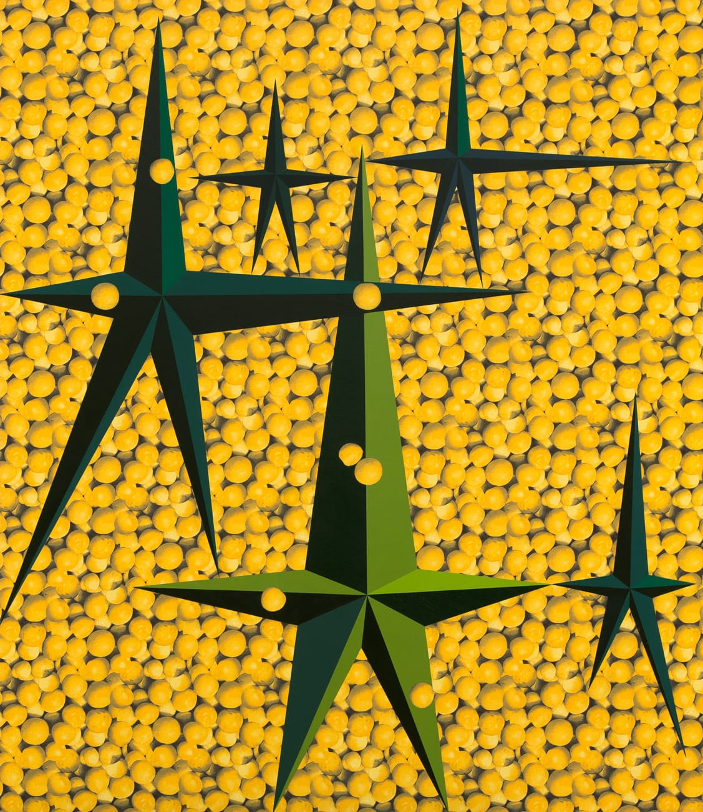 | Fondo de pequeñas esferas amarillas apiladas, pintadas con sombras que les dan volumen. Sobre él se disponen cinco estrellas de varias puntas en tonos de verde oscuro y verde claro, de distintos tamaños. Algunas esferas amarillas más grandes parecen posadas sobre las puntas de las estrellas. Técnica: acrílico sobre lienzo. | 50 | no |
| `obra-52` | Ecua-error | 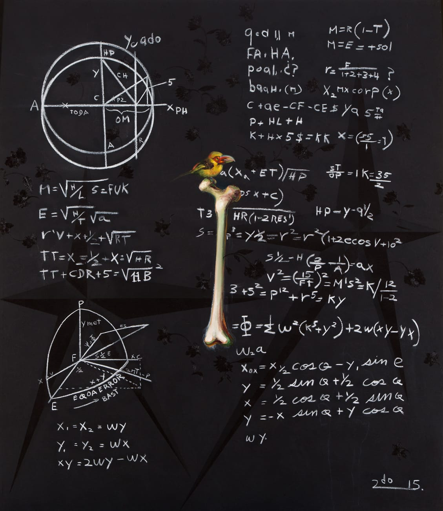 | Fondo negro tipo pizarra con fórmulas y diagramas dibujados en blanco, entre ellos círculos, ejes y ecuaciones. En el centro se ve un fémur pintado con realismo, con un pequeño pájaro de plumas verdes y amarillas posado en su extremo superior. Detrás se adivina una estrella oscura. Firmado y fechado abajo a la derecha. Técnica: acrílico y óleo sobre lienzo. | 60 | no |
| `obra-53` | Cardinales suicidas | 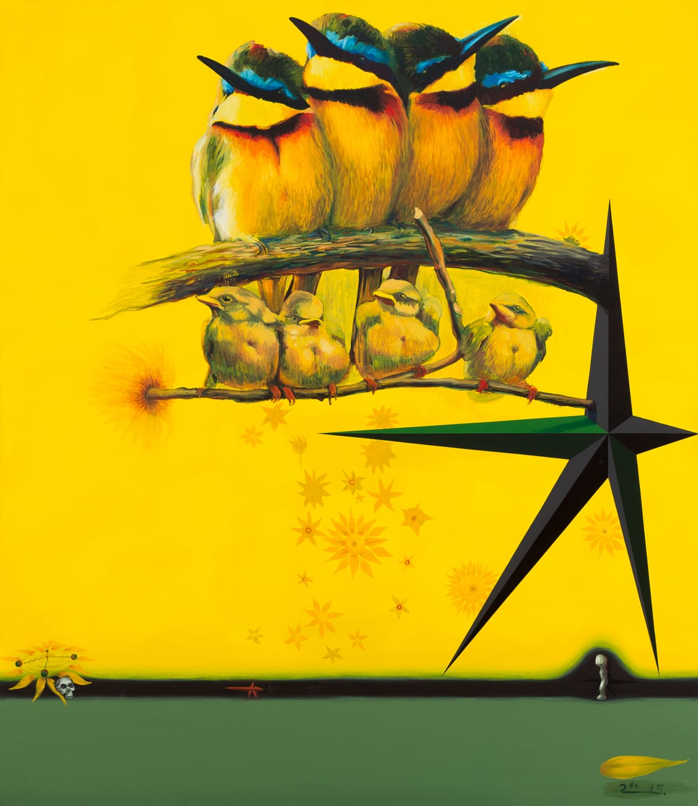 | Sobre un fondo amarillo intenso, cuatro aves adultas de pecho amarillo y antifaz azul y negro se juntan en una rama. Debajo, cuatro polluelos se posan en otra rama más fina. A la derecha sale una estrella negra con facetas verdes. Abajo hay una franja verde y pequeños detalles. Técnica: acrílico sobre lienzo. | 53 | no |
| `obra-54` | Estrellas maduras | 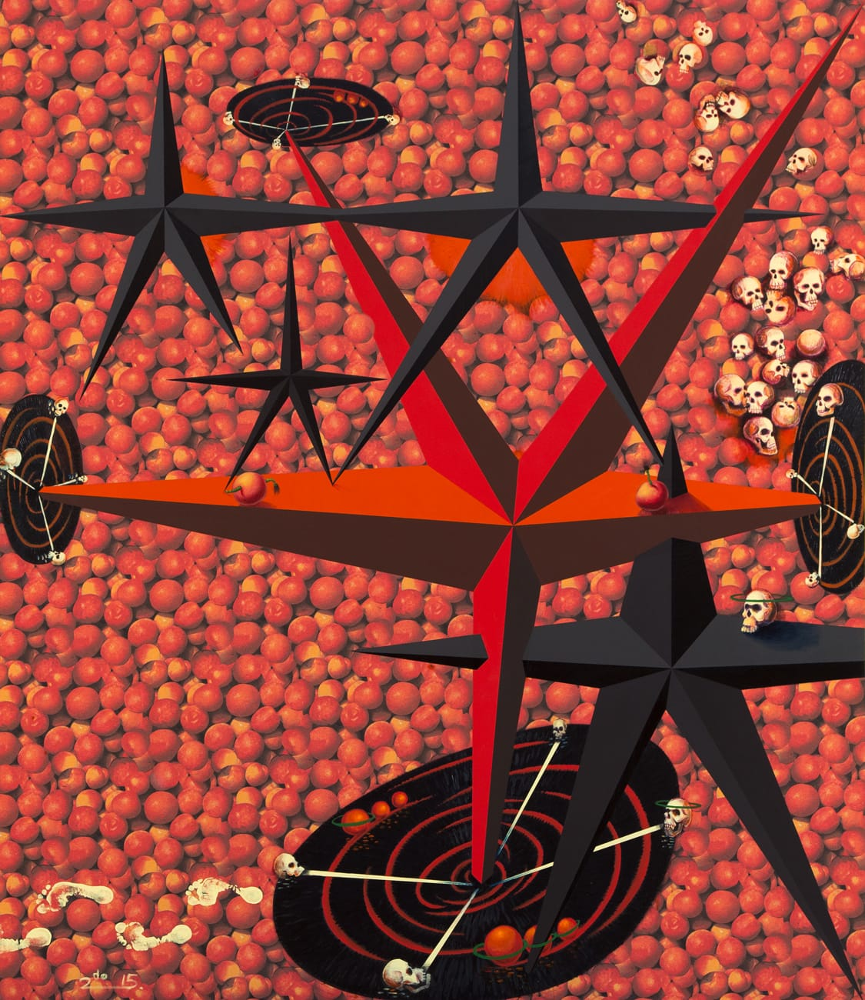 | Fondo de esferas rojas y naranjas apiladas, con varias estrellas negras de puntas largas y una estrella roja y naranja en el centro. Hay discos oscuros con círculos concéntricos y líneas blancas, cráneos pequeños agrupados a la derecha y huellas de pies claras abajo a la izquierda. Técnica: acrílico sobre lienzo. | 51 | no |
| `obra-55` | Daltónico | 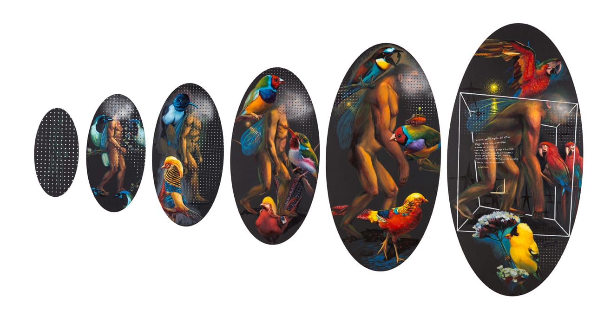 | Seis óvalos negros de tamaño creciente, de izquierda a derecha, se alinean sobre fondo blanco. El primero es pequeño y punteado; en los siguientes aparece una figura humana desnuda acompañada de más aves de colores, como un loro rojo y un faisán dorado. El último óvalo incluye un cubo dibujado en líneas blancas. Técnica: acrílico y óleo sobre lienzo. | 59 | no |
| `obra-58` | Daltónico 3 | 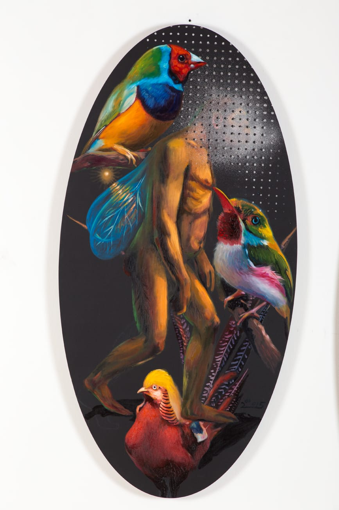 | Óvalo vertical negro, fotografiado sobre una pared blanca. Dentro, una figura humana desnuda y alargada con un ala azul transparente en la espalda. La rodean un ave de cabeza roja y azul arriba, un pájaro de pecho blanco y rosa a la derecha y un faisán rojo y amarillo abajo. Arriba a la derecha hay una zona de puntos. Técnica: acrílico y óleo sobre lienzo. | 65 | no |
| `obra-56` | Daltonico 1 | 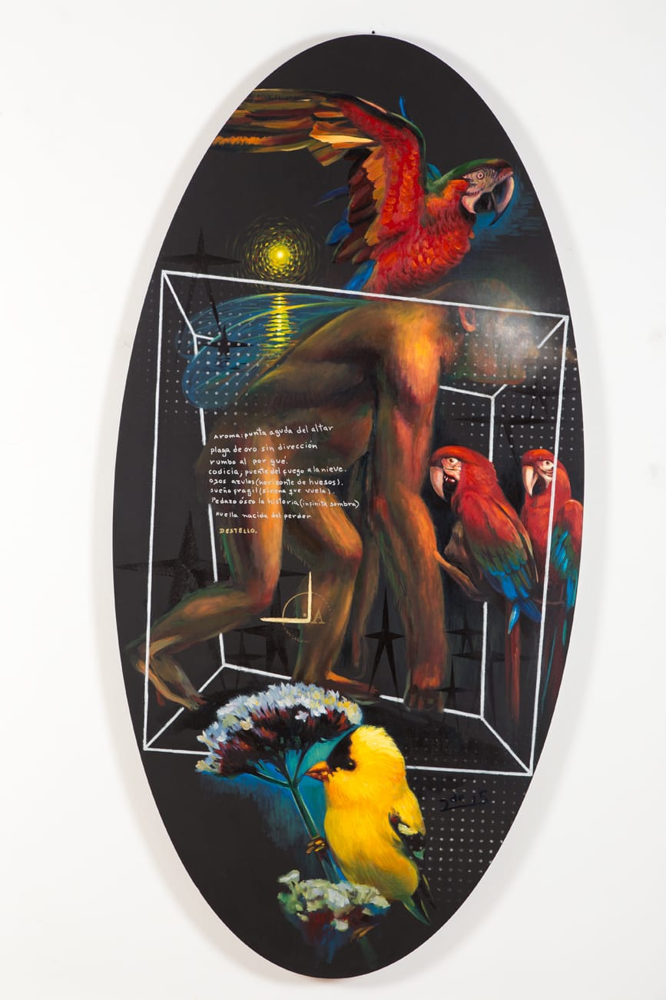 | Óvalo vertical de fondo negro con una figura humana desnuda y caminando, de piel anaranjada, dentro de un cubo dibujado con líneas blancas. Alrededor hay un guacamayo rojo con las alas abiertas, otros dos guacamayos, un jilguero amarillo y flores blancas. Un texto manuscrito blanco ocupa el centro. Está hecho en acrílico y óleo sobre lienzo. | 56 | no |
| `obra-57` | Daltónico 2 | 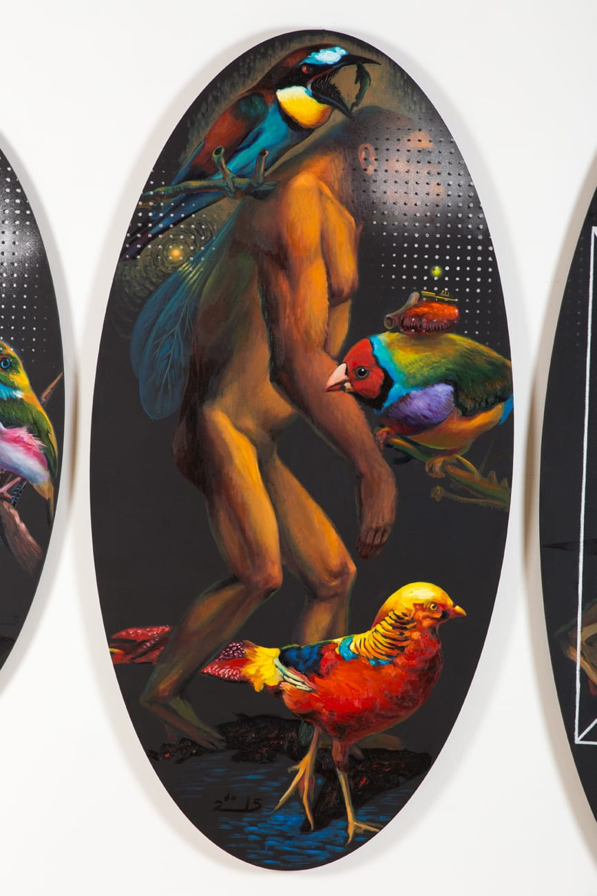 | Óvalo vertical oscuro con una figura humana desnuda y de piel anaranjada, con cabeza de ave de pecho amarillo y alas de insecto traslúcidas. Junto a ella hay un pájaro de cabeza roja y plumaje de colores, y un faisán dorado rojo y amarillo en la parte baja. Puntos blancos forman una trama sobre el fondo. Acrílico y óleo sobre lienzo. | 61 | no |
| `obra-59` | Daltónico 4 | 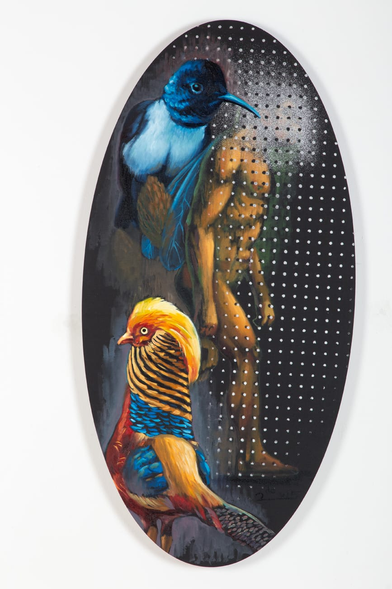 | Óvalo vertical negro con una cuadrícula de puntos blancos. Una figura humana desnuda, de piel dorada, aparece de espaldas junto a un ave de cabeza azul oscura y pico largo y curvo, y delante un faisán dorado de cresta amarilla y plumas rayadas. Acrílico y óleo sobre lienzo. | 48 | no |
| `obra-60` | Daltónico 5 y 6 | 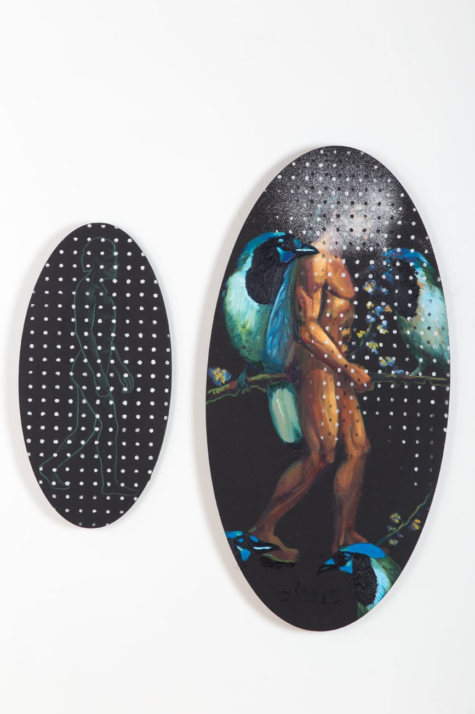 | Dos óvalos negros cubiertos de puntos blancos, colgados en la pared. El de la derecha muestra una figura humana desnuda y caminando, con aves de plumaje azul y verde detrás y a sus pies. El de la izquierda, más pequeño, solo tiene el contorno tenue de una figura. Acrílico y óleo sobre lienzo. | 53 | no |
| `obra-61` | Nostalgia | 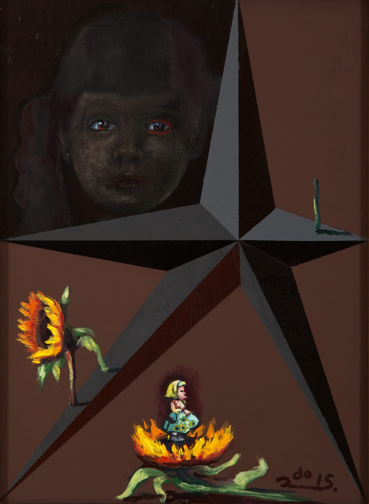 | Sobre un fondo marrón rojizo hay una estrella negra de cuatro puntas y, en la esquina superior izquierda, un rostro de niño en tonos oscuros. Abajo aparecen dos girasoles, y sobre el inferior una pequeña figura con vestido azul y amarillo. En la esquina inferior derecha se lee la firma y el año. Acrílico y óleo sobre lienzo. | 58 | no |
| `obra-62` | Estrella y razón, puente y mapa. Una vez ave, rama. Dolor cubierto sin retorno, sin alas. Humo antiguo |  | Composición horizontal con fondo morado y un rectángulo gris. En el centro, un círculo naranja con una estrella negra, y sobre él un faisán dorado y un pájaro de cabeza roja. A los lados hay un círculo verde, un ave azul, un niño de cabeza pálida y rostros pintados. Acrílico y óleo sobre lienzo. | 54 | no |
| `obra-63` | Visión múltiple |  | Fondo rojo con tres figuras al estilo clásico: dos mujeres con túnicas, en tonos rojizos, y un joven vestido de blanco que sostiene una espada. A la derecha, un círculo claro con un ave grande de cabeza rosada y cuerpo azul. Flores de colores y un marco negro estampado rodean la escena. Acrílico y óleo sobre lienzo. | 57 | no |
| `obra-64` | El secreto |  | Lienzo circular de fondo celeste, montado sobre madera negra tallada con motivos de flores. Dos aves grandes, una de cresta naranja y otra negra de pico amarillo, flanquean una estrella negra. Entre flores rosadas se ven pequeños niños, algunos con alas. Acrílico y óleo sobre lienzo circular montado en madera tallada. | 51 | no |
| `obra-65` | Esperanza |  | Lienzo circular de fondo gris con decenas de pequeños esqueletos vestidos y bailando. En el centro, dos calaveras grandes de las que salen tallos con flores amarillas, sobre una mancha negra con estrellas. El marco es de madera negra tallada. Acrílico y óleo sobre lienzo montado en madera tallada. | 49 | no |
| `obra-66` | Esperanza |  | Vista lateral de un lienzo circular colgado en la pared. Se ven dos calaveras grandes y varios esqueletos pequeños con ropa de colores sobre fondo gris. El borde del soporte y la madera negra tallada que lo rodea aparecen en perspectiva. Acrílico y óleo sobre lienzo montado en madera tallada. | 50 | no |
| `obra-67` | Livianos |  | Lienzo circular de fondo rosa salmón sobre madera negra tallada. Un ave grande de cresta naranja y pico largo se posa en una rama con tulipanes blancos y rosados. A la derecha, una niña de vestido rosa se toca la cabeza junto a un niño pelirrojo de pico largo; detrás, una estrella negra. Acrílico y óleo sobre lienzo. | 58 | no |
| `obra-68` | Livianos |  | Toma en ángulo de un lienzo circular de fondo naranja, con una niña de blusa clara que se lleva la mano a la cabeza y un niño pelirrojo de perfil con nariz larga. A la izquierda asoma un ave de cresta roja y detrás una estrella negra. La madera negra tallada rodea el lienzo. Acrílico y óleo sobre lienzo. | 59 | no |
| `obra-69` | Cazador de estrellas |  | Sobre un fondo verde claro, una niña de vestido azul con lazo y bolsillo blanco sostiene un paraguas cerrado. Cerca hay una garza, una cabeza de niña con trenzas, un corazón anatómico sobre un muñeco naranja y un grupo de personajes pequeños con sombreros. Un marco marrón rodea la imagen. | 50 | no |
| `obra-70` | Entre el día y la noche |  | Composición cuadrada de colores intensos: círculos naranjas, morados y rojos sobre un fondo de papel floral. Una niña de falda amarilla y sombrero oscuro sostiene una jarra, un mono rojo con un aro verde está agachado, y un niño de camisa verde mira un jarrón con rosas y tulipanes. | 49 | no |
| `obra-71` | Entre duendes y cielo verde |  | Pintura dentro de un marco antiguo de madera gris y dorada, con flores naturales de orquídea, girasol y hojas que salen por el lado derecho. En la escena roja y verde hay dos niñas con ropa tradicional, ocho siluetas negras de duendes en fila y un círculo con animales. Acrílico y óleo sobre lienzo, marco y flores. | 57 | no |
| `obra-72` | Constelaciones |  | Pintura vertical y estrecha sobre fondo negro salpicado de pequeñas estrellas de colores. En el centro hay una figura clara, casi blanca, con rostro de payaso, una cabeza roja de animal con collar azul y zapatillas de ballet azules. Hay manchas y salpicaduras blancas que se extienden hacia abajo y a los lados, con toques turquesa y rojo. | 58 | no |
| `obra-73` | Constelaciones |  | Composición vertical sobre fondo oscuro con estrellas de cinco puntas verdes, naranjas y rojas. Varias cabezas se apilan: un cráneo gris, un rostro pálido con nariz roja, un hombre barbudo de cabello naranja y una mujer de piel rosada de cuyo cuerpo cae un chorro rosa. Abajo hay unas botas rojas y, a la derecha, un brazo con huesos a la vista. | 62 | no |
| `obra-74` | Constelaciones |  | Pintura vertical con marco verde y fondo oscuro con manchas blancas y doradas. A la derecha hay un personaje de pelo naranja y rostro alargado que sostiene un pequeño insecto con alas, y debajo un jarrón rojo y verde. Se ven pies y manos rojos recortados, una cara con ojos azules y grandes estrellas verdes de cinco puntas. | 58 | no |
| `obra-75` | Constelaciones |  | Conjunto horizontal sobre fondo gris claro: arriba, cinco discos con estrellas de cinco puntas en crema, salmón, verde oliva, granate y negro. Debajo, una larga banda ondulada reúne escenas pequeñas: dos niños abrazados, flores en jarrones, figuras de pie y estrellas grandes. Un pequeño óvalo oscuro aparece a la izquierda. | 50 | no |
| `obra-76` | Lemas e himnos mutilados |  | Dos pinturas circulares sobre fondo gris claro, ejecutadas en acrílico y óleo sobre lienzo. La de la izquierda es crema con borde azul pálido, una estrella negra y una forma roja y verde, además de círculos lila y amarillo. La de la derecha es salmón, con una estrella roja y crema y círculos violeta y verde. | 56 | no |
| `obra-77` | Lemas e himnos mutilados (detalle) |  | Dos pinturas circulares sobre fondo gris claro, en acrílico y óleo sobre lienzo. La de la izquierda es granate, con varias estrellas naranjas y verdes de distinto tamaño y círculos rojos y rosa. La de la derecha es negra, con una gran estrella naranja, roja y crema, una estrella verde pequeña al centro y un fragmento turquesa y rojo. | 59 | no |
| `obra-78` | Lemas e himnos mutilados (detalle) |  | Dos piezas sobre fondo gris claro, en acrílico sobre lienzo. A la izquierda, un óvalo negro con un esqueleto con corona y alas translúcidas que sostiene un girasol sobre agua azul. A la derecha, un disco verde oliva con una estrella de cinco puntas en rojo, naranja, crema, amarillo y verde, con un centro azul. | 55 | no |
| `obra-79` | Lemas e himnos mutilados (detalle) |  | Pintura en acrílico y óleo sobre lienzo, con marco negro. Un disco verde brillante contiene a un hombre barbudo y sin camisa, con una piel azulada en la cintura. Detrás hay dos niñas, una con vestido rojo, y sobre el fondo negro se ven dibujos finos de plantas. A la derecha hay flores rojas y blancas en un vaso y dos estrellas negras. | 63 | no |
| `obra-80` | Aroma a razón |  | Pintura en acrílico y óleo sobre lienzo montado en madera tallada, con marco negro. Un disco rojo muestra a una figura de pelo largo y piel de animal que carga a un niño de cabello verde. A la izquierda hay un jarrón oscuro con ramas de flores amarillas. A la derecha, un hombre verde de perfil y una silueta blanca sobre el fondo negro. | 64 | no |
| `obra-81` | Maternidad y tres moscas |  | Pintura en acrílico y óleo sobre lienzo montado en madera tallada. Es un detalle visto de lado: sobre un disco rojo, una figura de pelo oscuro abraza a un niño de cabello verde. A la derecha asoma un personaje de ropa verde con una banda roja, y el fondo negro muestra líneas finas claras. A la izquierda se ven ramas amarillas. | 61 | no |
| `obra-82` | Maternidad y 3 moscas (detalle) |  | Fotografía de un detalle de la obra, tomada de lado y de cerca. Se ve una figura de pelo oscuro que abraza a un niño de cabello verde sobre fondo rojo, con tonos naranja y rosa en la piel. A la derecha hay una figura con ropa verde y una banda roja, junto a un fondo negro con vetas claras. | 60 | no |
| `obra-83` | Levitando |  | Fotografía de dos obras en acrílico y óleo sobre lienzo, dentro de cajas blancas. Arriba, una pieza horizontal con bloques planos lila, amarillo, verde y naranja, y una pequeña figura con orejas rojas. Abajo, dos lienzos: uno con manchas de color y pájaros blancos, otro con una figura coronada y formas blancas y rojas. | 54 | no |
| `obra-84` | Horizontando la razón (autorretrato) |  | Fotografía de dos obras en acrílico y óleo sobre lienzo. A la izquierda, un hombre desnudo y delgado, de piel pálida y manos rojas, sentado sobre fondo marrón oscuro, con una franja verde sobre la cabeza. A la derecha, en marco dorado, formas triangulares rosas, verdes, amarillas y negras sobre beige y fondo oscuro. | 54 | no |
| `obra-85` | Conjunto de la serie “acertijos” |  | Fotografía de cuatro pinturas en acrílico y óleo sobre lienzo. Arriba a la izquierda, una figura con pico rojo y alas sobre fondo oscuro. Arriba a la derecha, una bota roja sobre un fondo crema con franjas verdes. Abajo, un animal amarillo y una mujer de pelo largo con una pequeña ala verde. | 53 | no |
| `obra-86` | Conjunto de la serie “acertijos” |  | Fotografía de cuatro obras en acrílico y óleo sobre lienzo. Arriba a la izquierda, una figura blanca con sombrero puntiagudo entre muchos ojos, junto a un círculo negro. Arriba a la derecha, un personaje de sombrero verde sobre fondo amarillo, con el texto «¿Y luego?». Abajo, un collage de círculos sobre cartón y una escena roja con un esqueleto. | 59 | no |
| `obra-87` | Conjunto de la serie “acertijos” |  | Composición de cuatro lienzos agrupados: un hombre desnudo sentado en un tronco pesca con una caña un pequeño muñeco colgado; un personaje de abrigo naranja y sombrero verde sobre fondo violeta; una mancha oscura con trazos verdes sobre fondo claro; y una figura femenina de rojo sobre fondo rojo. Acrílico y óleo sobre lienzo. | 54 | no |
| `obra-88` | Legendario colmillo de tiempo, en mi sueño tu venir |  | Lienzo muy vertical con marco rojo y borde naranja. Una figura oscura de cabeza redonda y un ojo azul, con dientes visibles y un collar de pequeños cráneos, se alarga hacia abajo entre manchas grises y marrones atravesadas por hilos finos. Acrílico y óleo sobre lienzo. | 46 | no |
| `obra-89` | Naufra-go |  | Lienzo vertical de fondo verde oliva cubierto de pequeñas flores amarillas y rojas. En el centro, una figura de cara naranja con ojos saltones y gorro rojo, sobre una mancha gris y roja que sube hacia arriba. Al pie se lee el título. Acrílico y óleo sobre lienzo. | 48 | no |
| `obra-90` | Por los mares de sangre |  | Lienzo vertical de fondo rojo intenso con borde marrón. Arriba, un cráneo grisáceo de ojos oscuros y una lágrima azul; una franja negra desciende hasta una cabeza con bigote y pajarita. A la izquierda, una pequeña barca azul con círculos amarillo y naranja. Acrílico y óleo sobre lienzo. | 48 | no |
| `obra-91` | Constelación |  | Lienzo vertical de fondo negro con salpicaduras blancas. Un personaje de perfil con barba verde y azul fuma una pipa, con mechones naranjas a los lados; encima, una cabeza con sombrero azul, y debajo, un muñeco pequeño de rostro gris. Acrílico y óleo sobre lienzo. | 45 | no |
| `obra-92` | Aliento infinito |  | Tríptico horizontal: dos paneles con jarrones de flores sobre mesas redondas, con girasol, agapantos y flores rojas, y entre ellos un panel central oscuro con siluetas grabadas. Fondos de verde, violeta, rojo y blanco, y marcos negros con tallado. Acrílico y óleo sobre lienzo y madera tallada. | 47 | no |
| `obra-93` | Aliento infinito # 1 |  | Jarrón alto y un florero pequeño con girasol, agapantos y flores rojas sobre una mesa redonda oscura. Detrás, bandas de verde, rojo y violeta, círculos claros y ramas con frutas. Un marco negro con tallado de trazos blancos rodea la imagen. Acrílico y óleo sobre lienzo. | 46 | no |
| `obra-94` | Aliento infinito #2 |  | Jarrón alto y un florero pequeño con girasol, agapantos y flores rojas y amarillas sobre una mesa redonda roja oscura. Un gran círculo blanco ocupa el fondo, con tonos violeta, rosa y turquesa y esferas de colores. Marco negro tallado con siluetas. Acrílico y óleo sobre lienzo, marco tallado. | 49 | no |
| `obra-95` | Serie Acertijos |  | Siete lienzos pequeños agrupados en dos filas: una niña con un ave oscura, un cráneo claro con ojos verdes, una joven de rojo sentada, un niño sobre círculo verde, dos figuras con kimono, dos payasos de azul y un hombre sentado de verde. Colores saturados y fondos con círculos. Acrílico y óleo sobre lienzo. | 54 | no |
| `obra-96` | Serie Acertijos |  | Siete lienzos pequeños agrupados en dos filas, con niños de ropas antiguas: tres niños con una estrella sobre fondo violeta, una niña con zancudas y un paraguas, dos niños corriendo de la mano, una niña con un ave roja, y figuras con abrigos. Fondos de círculos rojos y verdes. Acrílico y óleo sobre lienzo. | 54 | no |
| `obra-97` | Serie Acertijos |  | Ocho lienzos pequeños agrupados en dos filas, con niñas y figuras de ropas antiguas sobre círculos y formas de color: dos niñas abrazadas, una con sombrero naranja, otra con gorro de cocinera junto a un ave verde, y un cráneo entre figuras. Dominan rojo, violeta, verde y naranja. Acrílico y óleo sobre lienzo. | 53 | no |
| `obra-98` | Serie Muñecas típicas |  | Dos lienzos horizontales apilados. Arriba, cinco muñecas con trajes de época sobre fondo rojo, con plantas oscuras en primer plano. Abajo, cuatro muñecas con velo, kimono, pañuelo y gorro de piel sobre fondo verde agua. Acrílico y óleo sobre tela. | 40 | no |
| `obra-99` | Serie Muñecas típicas |  | Dos lienzos horizontales apilados. Arriba, cuatro muñecas con trajes tradicionales ante un fondo azul, con plantas negras en primer plano. Abajo, en marco claro, una niña con pañuelo a la izquierda y otra sentada al centro, con siluetas negras y fondo rojo. Acrílico y óleo sobre tela. | 47 | no |
| `obra-100` | Luz de nada, visión etérea |  | Lienzo horizontal de fondo salmón con un jarrón alto y un florero pequeño sobre una mesa redonda oscura, con girasol y flores azules. Al fondo, una mujer de perfil con flores rojas, un candelabro violeta, círculos blancos y siluetas negras de plantas. Acrílico y óleo sobre tela. | 47 | no |
| `obra-101` | Gota de sangre |  | Cuadro cuadrado dividido en dos mitades: a la izquierda, fondo rosa con círculos y una figura naranja de tres ojos con palmeras sobre la cabeza; a la derecha, fondo negro con el personaje barbudo que fuma pipa. Borde violeta y manchas grises. Acrílico y óleo sobre tela. | 47 | no |
| `obra-102` | Gota de sangre |  | Gota de sangre, acrílico y óleo sobre lienzo, de 2009. Una figura roja de tres ojos, con dos palmeras sobre la cabeza, está formada por brazos horizontales y piernas delgadas que terminan en un pie grande. El fondo rosa lleva círculos blancos, rojos y azules, manchas grises y marrones, y un marco morado. | 53 | no |
| `obra-103` | Danza en el bosque |  | Danza en el bosque, acrílico y óleo, de 2009. Sobre un fondo rojo, una niña con sombrero verde y vestido naranja sostiene una rama donde se posa un colibrí. Detrás hay pinos oscuros y círculos anaranjados. Abajo, un gato negro mira a una fila de pequeñas figuras verdes y otro colibrí vuela cerca. | 53 | no |
| `obra-104` | Como una espina |  | Como una espina, acrílico y óleo, de 2006. A la derecha, un rostro blanco con una máscara verde sobre la nariz y un sombrero naranja con manchas lleva una segunda cara pequeña junto al ojo. Lo rodea un fondo de triángulos de colores. A la izquierda, un panel rosa muestra una estrella dorada, ojos y pequeñas esferas rojas, con texto escrito. | 61 | no |
| `obra-105` | Sangrar el horizonte |  | Sangrar el horizonte, acrílico y óleo, de 2006. Tres paneles rosados sobre un fondo lila: en el primero, dos huevos fritos unidos por una línea; en el segundo, un árbol seco, una figura con ojos y un personaje peludo con un pollito en un cuenco; abajo, una rosa en un tallo largo con tres hilos que cuelgan. | 57 | no |
| `obra-106` | Adán |  | Adán, acrílico y óleo, de 2006. El fondo pasa del amarillo arriba al crema y al rojizo abajo. En el centro hay figuras dibujadas de manera tenue: una mujer con una vasija y una cesta, niños con pañuelos rojos y un gallo. Una silueta verde con una forma blanca y ovalada como cabeza se apoya sobre dos pies en una base marrón. | 62 | no |
| `obra-107` | Eva |  | Eva, acrílico y óleo, de 2006. Sobre un fondo amarillo y crema con una franja rojiza abajo, una figura blanca de largas piernas tiene un ojo en forma de diana y un pico alargado. A la derecha se apilan niños con pañuelos rojos y una mujer con falda, dibujados con trazo suelto. Un perrito pequeño pasa entre las piernas. | 59 | no |
| `obra-108` | El enigma 2 |  | El enigma 2, acrílico y óleo, de 2006. A la izquierda, dos niños se abrazan bajo un árbol grande sobre un fondo rojo y azul oscuro. A la derecha, sobre una zona clara, un niño con pantalón rojo y una niña con trenzas están de pie. En el centro flotan flores blancas, libros rojos y un óvalo amarillo con un islote. | 61 | no |
| `obra-109` | Vestido de agua |  | Vestido de agua, acrílico y óleo, de 2006. Un paisaje de cielo azul claro con un árbol grande a la izquierda, en cuyas ramas se sienta una figura azul. Hay nubes azules planas, ramas sueltas que gotean, un árbol seco y una casa pequeña con humo a la derecha. Abajo, el horizonte pasa del verde al rojo y al naranja. | 60 | no |
| `obra-110` | Cinco puntos cardinales |  | Cinco puntos cardinales, acrílico y óleo, de 2006. Sobre un fondo azul pálido hay una silueta blanca de una figura de pie, con su sombra gris detrás. Cuatro círculos negros grandes se reparten por el lienzo. A la derecha, flores, hojas y colibríes naranjas y verdes están unidos por líneas negras finas a pequeñas figuras. | 55 | no |
| `obra-111` | Allá |  | Allá, óleo y acrílico sobre lienzo, en formato circular. Un niño con abrigo rojo levanta la mano hacia un sol de rayos oscuros sobre un fondo naranja. Frente a él hay cuatro ranas verdes con manchas rojas, una vaca lejana, una valla y una franja rosa en el horizonte. | 49 | no |
| `obra-112` | El espejo |  | El espejo, óleo y acrílico sobre lienzo, en formato circular. Un niño de pelo rizado y camiseta de rayas sujeta con las manos dos patas largas de un ave blanca de alas abiertas. A la izquierda, un lobo de hocico abierto está en el agua. El fondo es verde azulado, con un óvalo amarillo, palmeras y orillas verdes. | 58 | no |
| `obra-113` | Pájaro del buen abuelo |  | Pájaro del buen abuelo, acrílico y óleo, de 2008, en formato circular. Un anciano de barba blanca y un halo dorado está sentado a la derecha rodeado de niños con ropa antigua, uno de ellos con un conejo blanco. Un colibrí grande ocupa la parte superior y una niña salta la cuerda. El título aparece escrito abajo. | 57 | no |
| `obra-114` | Nada entonces tiene semejante emoción |  | Nada entonces tiene semejante emoción, acrílico y óleo, de 2008, en formato circular. Sobre un fondo rojo, una niña con sombrero verde y falda roja está de pie sobre un tocón, junto a una rosa. Hay soles naranjas, árboles en rojo más oscuro, una sombra negra de ramas, ratones sobre una barra y un gato negro. | 56 | no |
| `obra-115` | Universo bajo los pies 2 |  | Universo bajo los pies 2, acrílico y óleo sobre lienzo, de 2009, en formato circular. Sobre un fondo verde azulado, un niño camina con un sombrero en la espalda y una niña de azul se sienta entre flores amarillas. Discos negros con líneas rojas, un colibrí, una rosa roja y una sombra de hojas con puntos blancos rodean a las figuras. | 61 | no |
| `obra-116` | Danzando sobre la nada-2 |  | Danzando sobre la nada-2, acrílico y óleo sobre tela, de 2009. A la izquierda, sobre una franja roja, un conejo rojo y negro de gran sonrisa se apoya en una esfera negra. En el centro y a la derecha, sobre fondo crema, hay dos plantas con ojos, picos de aves, una figura gris de un niño con gorra y una cabeza roja con tres ojos. | 65 | no |
| `obra-117` | De la serie “Acertijos” |  | Una niña de pelo rojo, vestido azul con manchas claras y zapatos rojos, está sentada con una mano en la boca y sostiene una muñeca pequeña. Ambas aparecen dentro de un círculo oscuro con borde celeste, sobre un fondo azul profundo. Arriba, formas oscuras de aspecto vegetal sobresalen del círculo. Acrílico y óleo. | 53 | no |
| `obra-118` | De la serie “Acertijos” |  | Una figura de cabeza deformada, con ojos grandes sobre tallos, dientes visibles y un huevo frito en la mejilla, cruza los brazos sobre un fondo gris azulado. Detrás tiene un disco naranja con borde azul. Lleva un cuello de gotas azules, y abajo se lee «MONA LISA». Una tira roja pintada asoma por arriba. Acrílico y óleo. | 57 | no |
| `obra-119` | De la serie “Acertijos” |  | Sobre un fondo naranja, un círculo oscuro con borde verde reúne una tetera azul con rostro, una cabeza blanca de pintura espesa sobre una esfera roja y un hombre azul con sombrero lila y brazos cruzados. A la izquierda, esferas blancas y lilas se apilan en columna. Acrílico y óleo. | 50 | no |
| `obra-120` | Paisaje oriental cerca de las sombras |  | Dos mujeres de rasgos orientales, con túnicas claras y moños, caminan junto a una cerca lila en un paisaje de tonos tierra. A la derecha, un tronco oscuro con ramas de hojas rojas ocupa el borde. Círculos con motivos florales flotan sobre la escena, rodeada por un marco de papel floral. Acrílico y óleo sobre lienzo. | 56 | no |
| `obra-121` | De la serie “Acertijos” |  | Sobre un fondo rojo, un huevo frito grande con la yema amarilla ocupa la parte alta, delante de un disco azul oscuro. Abajo a la derecha aparece un torso de hombre con medio rostro verde, y detrás otra cara. A la izquierda hay una criatura con orejas largas y un árbol en un paisaje al atardecer. Acrílico y óleo. | 59 | no |
| `obra-122` | De la serie “Acertijos” |  | Una escena de estilo indio muestra un elefante oscuro con dos jinetes de túnica naranja y dos hombres a pie, sobre un desierto de color arena. Una figura roja y verde, alargada y de rostro frontal, cruza la imagen en vertical. Esferas oscuras flotan en el cielo, y una tela floral oscura enmarca el cuadro. Acrílico y óleo. | 58 | no |
| `obra-123` | Horizonte orientalmente huérfano |  | Dos niñas pequeñas de aspecto antiguo, en un rectángulo naranja con marco rojo oscuro. Una está de pie con la cabeza baja, con gotas azules cayendo de su ropa y canicas azules en el suelo. La otra, sentada, extiende la mano hacia una figura de hada. Tres círculos azul, verde y rojo cubren partes de la escena. Acrílico. | 58 | no |
| `obra-125` | Gota de rocío |  | Sobre un fondo azul, cuatro niños con sombreros y ropa de época se distribuyen por la escena, dos de ellos inclinados hacia delante. Un sol naranja asoma arriba a la izquierda. Aves oscuras de pico largo y flores rosadas atraviesan el centro entre ramas verdes. El marco es oscuro. Acrílico y óleo. | 52 | no |
| `obra-126` | Sombra proyectando su cuerpo |  | En un marco rojo, dos niños pequeños con sombrero se enfrentan sobre fondo claro: una niña sentada dentro de un círculo azul y otra figura de pie dentro de uno rojo. Un colibrí largo con flores cuelga entre ambos y otro vuela arriba a la izquierda. Siluetas oscuras de hojas se superponen. Acrílico y óleo. | 55 | no |
| `obra-127` | Contando planetas |  | Una niña de pelo suelto y vestido blanco está sentada en el centro, sobre una mancha verde y rodeada de puntos blancos. A la izquierda, un círculo naranja con figuras pequeñas; a la derecha, colibríes y flores. Una fila de muñecos asoma arriba, sobre un fondo naranja con marco rojo. Acrílico y óleo sobre tela. | 55 | no |
| `obra-128` | Liviano universo etéreo |  | Sobre un fondo azul intenso, un rectángulo claro y ladeado contiene una silueta lila de flores grandes en el centro. A los lados hay dos círculos pequeños, uno con un perro y aves azules sobre una rama, otro con dos niños que caminan. Siluetas de plantas oscuras y círculos blancos cubren los bordes. Acrílico y óleo. | 56 | no |
| `obra-129` | Etéreamente, aliento, monumento, estar |  | Una niña con sombrero verde y vestido rojo se arrodilla frente a un nido con huevos, sobre una forma circular lila. A la izquierda, un círculo claro muestra siluetas lilas de plantas y dos pequeños cuadrados rojos unidos por líneas finas. El fondo es azul intenso, con un marco claro detrás. Acrílico y óleo. | 54 | no |
| `obra-131` | Adonde fué el amor |  | Una niña de pelo suelto y vestido blanco se sienta en el centro de un rectángulo gris, entre puntos blancos. A la izquierda, un ave de plumaje azul y cresta roja asoma abajo; a la derecha, dos colibríes vuelan. Arriba hay una fila de muñecos pequeños y círculos amarillos, dentro de un marco negro. Acrílico y óleo. | 57 | no |
| `obra-07` | Guardián del jardín |  | Tres niñas ocupan la escena: una con sombrero verde y vestido rojo a la izquierda, otra de vestido amarillo con una flor en la mano al centro, y otra de pelo rojo y vestido verde a la derecha. Las rodean enredaderas, loros, una estrella gris y plantas oscuras, con tonos naranja y rojo. Técnica mixta sobre tabla. | 57 | no |
| `obra-08` | El encuentro |  | Una niña de sombrero verde con lunares y vestido rojo se agacha ante un nido con huevos, sobre un círculo lila. A la izquierda, un círculo claro muestra siluetas lilas de plantas y dos cuadrados rojos con líneas finas. El fondo es azul intenso con un recuadro celeste. Técnica mixta sobre tabla. | 52 | no |
| `obra-09` | Aves nocturnas |  | Cuatro aves de colores intensos sobre un fondo gris oscuro con flores negras brillantes: un ave azul con cresta blanca, un tucán de pico grande con plumaje amarillo y rojo, y un faisán rojo y amarillo que pisa agua con círculos concéntricos. Técnica mixta sobre tabla. | 46 | no |
| `obra-10` | Jardín estelar |  | Sobre un fondo gris oscuro con estrellas fugaces pequeñas, un faisán dorado de pecho azul turquesa ocupa la izquierda. A la derecha hay un jilguero amarillo sobre una flor y un faisán más pequeño abajo, junto a un jarrón negro con follaje oscuro. Técnica mixta sobre tabla. | 47 | no |
| `obra-11` | Colibríes de cristal |  | Cuatro aves sobre un fondo azul claro con flores rojas y una estrella negra de ocho puntas: un colibrí de cabeza rosa y pecho azul dentro de un círculo blanco, otro verde y naranja sobre una rama, uno con cresta roja y un faisán en un óvalo oscuro. Técnica mixta sobre tabla. | 52 | no |
| `obra-12` | Atardecer alado |  | Tres colibríes y un faisán sobre fondo azul verdoso y morado, con flores rosadas dispersas y una estrella negra de puntas largas. Uno de los colibríes, de cabeza rosa, aparece dentro de un círculo blanco; el faisán rojo y amarillo está abajo a la derecha. Técnica mixta sobre tabla. | 49 | no |
